A Django **single-app template**: clone it, build your app in `ourapp/`, and drive
changes through an agent that edits a throwaway. **desmo** — the VM/instance
and service-user name — is a codename for this deployment.

## Install on your VM (production)

DNS for your domain must already point at the VM.  
You must get SSH into the machine.

One curl|bash command turns a fresh VM you administer — any cloud
Debian instance you can ssh into — into a running
deployment of a published ref of this repo. Ssh in and run:

```bash
curl -fsSL https://raw.githubusercontent.com/aitchnyu/agent-beta/main/deploy/install.sh \
  | sudo bash -s -- --base-url https://your.domain
```

- **`--base-url`** — the public origin, `https://host[:port]` . Omitted → loopback-only (the local test mode
  below). The first-run setup can set it later, on its screen.
- **`--release <tag>` / `--branch <name>`** — tag/branch; the
  default is the latest published tag (`main` when none exist).

The installer runs the full provision (`deploy/inside-vm.sh`, all phases)
and then runs a few self-tests.

The installer finishes in the ssh session you opened — running the
first-run setup once, then landing you at the machine's prompt as debian.
The site is **https://your.domain/**. The setup is one command,
`desmosetup`, run once:

- one screen for the domain, the first superuser, Google sign-in and the
  agent's provider;
- then the terminal steps and a report carrying the links — see
  [First-run setup (`desmosetup`)](#first-run-setup-desmosetup).

The login link signs you in once, then expires. A second superuser later, by
hand — from `/srv/desmo/main`, where `./run` lives (no email/password
signup exists, only row + one-time link):

```console
$ cd /srv/desmo/main
$ ./run djangomanage createuser You Name you@example.com --superuser
{"message": "Created user 'you' (you@example.com) + superuser/staff. login link: ./run djangomanage makeloginlink you@example.com", "created": true, "email": "you@example.com", "username": "you"}

$ ./run djangomanage makeloginlink you@example.com
{"message": "One-time login for 'you' (valid 60 min, single use):\nhttps://your.domain/login-with-secret/<key>/", "login_url": "https://your.domain/login-with-secret/<key>/"}
```

Each prints one JSON line — `message` is human-readable, the other fields
are for scripts.

The agent surface is the `pi` TUI (run as the user you ssh in as).
Providers and models change inside pi later (`/login`, `/model`); Google
by hand — see [Google OAuth (social login)](#google-oauth-social-login).

### First-run setup (`desmosetup`)

`desmosetup` runs once, at the end of the interactive install. It is the
only run: nothing in it asks what the machine already holds, and no
message names the command again. It is one screen; the terminal steps
follow once the screen is gone, then the report prints.

Four titled boxes tell the sections apart. They are taller than a small
terminal: they sit at the top, and the screen scrolls. Filled in, before
**Next** (80 columns, example values):

```text
 ⭘                                desmosetup
╭─ Domain ─────────────────────────────────────────────────────────────────────╮
│ ▊▔▔▔▔▔▔▔▔▔▔▔▔▔▔▔▔▔▔▔▔▔▔▔▔▔▔▔▔▔▔▔▔▔▔▔▔▔▔▔▔▔▔▔▔▔▔▔▔▔▔▔▔▔▔▔▔▔▔▔▔▔▔▔▔▔▔▔▔▔▔▔▔▔▔▎ │
│ ▊  your.domain                                                             ▎ │
│ ▊▁▁▁▁▁▁▁▁▁▁▁▁▁▁▁▁▁▁▁▁▁▁▁▁▁▁▁▁▁▁▁▁▁▁▁▁▁▁▁▁▁▁▁▁▁▁▁▁▁▁▁▁▁▁▁▁▁▁▁▁▁▁▁▁▁▁▁▁▁▁▁▁▁▁▎ │
╰──────────────────────────────────────────────────────────────────────────────╯

╭─ First superuser details ────────────────────────────────────────────────────╮
│ Super user first name:                                                       │
│ ▊▔▔▔▔▔▔▔▔▔▔▔▔▔▔▔▔▔▔▔▔▔▔▔▔▔▔▔▔▔▔▔▔▔▔▔▔▔▔▔▔▔▔▔▔▔▔▔▔▔▔▔▔▔▔▔▔▔▔▔▔▔▔▔▔▔▔▔▔▔▔▔▔▔▔▎ │
│ ▊  Jane                                                                    ▎ │
│ ▊▁▁▁▁▁▁▁▁▁▁▁▁▁▁▁▁▁▁▁▁▁▁▁▁▁▁▁▁▁▁▁▁▁▁▁▁▁▁▁▁▁▁▁▁▁▁▁▁▁▁▁▁▁▁▁▁▁▁▁▁▁▁▁▁▁▁▁▁▁▁▁▁▁▁▎ │
│                                                                              │
│ Super user last name:                                                        │
│ ▊▔▔▔▔▔▔▔▔▔▔▔▔▔▔▔▔▔▔▔▔▔▔▔▔▔▔▔▔▔▔▔▔▔▔▔▔▔▔▔▔▔▔▔▔▔▔▔▔▔▔▔▔▔▔▔▔▔▔▔▔▔▔▔▔▔▔▔▔▔▔▔▔▔▔▎ │
│ ▊  Doe                                                                     ▎ │
│ ▊▁▁▁▁▁▁▁▁▁▁▁▁▁▁▁▁▁▁▁▁▁▁▁▁▁▁▁▁▁▁▁▁▁▁▁▁▁▁▁▁▁▁▁▁▁▁▁▁▁▁▁▁▁▁▁▁▁▁▁▁▁▁▁▁▁▁▁▁▁▁▁▁▁▁▎ │
│                                                                              │
│ Super user email:                                                            │
│ ▊▔▔▔▔▔▔▔▔▔▔▔▔▔▔▔▔▔▔▔▔▔▔▔▔▔▔▔▔▔▔▔▔▔▔▔▔▔▔▔▔▔▔▔▔▔▔▔▔▔▔▔▔▔▔▔▔▔▔▔▔▔▔▔▔▔▔▔▔▔▔▔▔▔▔▎ │
│ ▊  jane@example.com                                                        ▎ │
│ ▊▁▁▁▁▁▁▁▁▁▁▁▁▁▁▁▁▁▁▁▁▁▁▁▁▁▁▁▁▁▁▁▁▁▁▁▁▁▁▁▁▁▁▁▁▁▁▁▁▁▁▁▁▁▁▁▁▁▁▁▁▁▁▁▁▁▁▁▁▁▁▁▁▁▁▎ │
╰──────────────────────────────────────────────────────────────────────────────╯

╭─ Google login (can skip) ────────────────────────────────────────────────────╮
│ Google key:                                                                  │
│ ▊▔▔▔▔▔▔▔▔▔▔▔▔▔▔▔▔▔▔▔▔▔▔▔▔▔▔▔▔▔▔▔▔▔▔▔▔▔▔▔▔▔▔▔▔▔▔▔▔▔▔▔▔▔▔▔▔▔▔▔▔▔▔▔▔▔▔▔▔▔▔▔▔▔▔▎ │
│ ▊  1234567890-abc123.apps.googleusercontent.com                            ▎ │
│ ▊▁▁▁▁▁▁▁▁▁▁▁▁▁▁▁▁▁▁▁▁▁▁▁▁▁▁▁▁▁▁▁▁▁▁▁▁▁▁▁▁▁▁▁▁▁▁▁▁▁▁▁▁▁▁▁▁▁▁▁▁▁▁▁▁▁▁▁▁▁▁▁▁▁▁▎ │
│                                                                              │
│ Google secret:                                                               │
│ ▊▔▔▔▔▔▔▔▔▔▔▔▔▔▔▔▔▔▔▔▔▔▔▔▔▔▔▔▔▔▔▔▔▔▔▔▔▔▔▔▔▔▔▔▔▔▔▔▔▔▔▔▔▔▔▔▔▔▔▔▔▔▔▔▔▔▔▔▔▔▔▔▔▔▔▎ │
│ ▊  •••••••••••••••••••••••••••••••••••••                                   ▎ │
│ ▊▁▁▁▁▁▁▁▁▁▁▁▁▁▁▁▁▁▁▁▁▁▁▁▁▁▁▁▁▁▁▁▁▁▁▁▁▁▁▁▁▁▁▁▁▁▁▁▁▁▁▁▁▁▁▁▁▁▁▁▁▁▁▁▁▁▁▁▁▁▁▁▁▁▁▎ │
╰──────────────────────────────────────────────────────────────────────────────╯

╭─ Pi provider ────────────────────────────────────────────────────────────────╮
│ Pi provider:                                                                 │
│ ▊▔▔▔▔▔▔▔▔▔▔▔▔▔▔▔▔▔▔▔▔▔▔▔▔▔▔▔▔▔▔▔▔▔▔▔▔▔▔▔▔▔▔▔▔▔▔▔▔▔▔▔▔▔▔▔▔▔▔▔▔▔▔▔▔▔▔▔▔▔▔▔▔▔▔▎ │
│ ▊  zai                                                                  ▼  ▎ │
│ ▊▁▁▁▁▁▁▁▁▁▁▁▁▁▁▁▁▁▁▁▁▁▁▁▁▁▁▁▁▁▁▁▁▁▁▁▁▁▁▁▁▁▁▁▁▁▁▁▁▁▁▁▁▁▁▁▁▁▁▁▁▁▁▁▁▁▁▁▁▁▁▁▁▁▁▎ │
│                                                                              │
│ API key:                                                                     │
│ ▊▔▔▔▔▔▔▔▔▔▔▔▔▔▔▔▔▔▔▔▔▔▔▔▔▔▔▔▔▔▔▔▔▔▔▔▔▔▔▔▔▔▔▔▔▔▔▔▔▔▔▔▔▔▔▔▔▔▔▔▔▔▔▔▔▔▔▔▔▔▔▔▔▔▔▎ │
│ ▊  •••••••••••••••••••                                                     ▎ │
│ ▊▁▁▁▁▁▁▁▁▁▁▁▁▁▁▁▁▁▁▁▁▁▁▁▁▁▁▁▁▁▁▁▁▁▁▁▁▁▁▁▁▁▁▁▁▁▁▁▁▁▁▁▁▁▁▁▁▁▁▁▁▁▁▁▁▁▁▁▁▁▁▁▁▁▁▎ │
╰──────────────────────────────────────────────────────────────────────────────╯

 ▔▔▔▔▔▔▔▔▔▔▔▔▔▔▔▔
       Next
 ▁▁▁▁▁▁▁▁▁▁▁▁▁▁▁▁

 Fill the fields, then press Next
```

- **Domain** — required, with no suggestion: type a domain, a subdomain,
  or `https://localhost:8443` literally for a local install.
- **First superuser details** — the three fields are required.
  - The account they name is created; nothing is looked up first.
- **Google login (can skip)**
  - Both fields empty means Google login is not set.
  - Both given stores them — see
    [Google OAuth (social login)](#google-oauth-social-login).
- **Pi provider** — the dropdown pi's registry fills.
  - A provider that takes a key shows the **API key** field, masked.
  - A provider that only signs in starts nothing yet: its sign-in runs
    on the terminal after Next.
- **Next** is refused while
  - the domain is empty, or is neither a domain, a subdomain, nor
    `https://localhost:8443`;
  - a name, the email or the provider is missing;
  - Google has only one of its two fields;
  - the provider takes a key and the key is empty.
- A refused field gets its message under the input, and a toast at the
  bottom lists every refused field with its message; the view goes to the
  first one. The status line names them too.
- No key leaves the screen: ctrl+q and ctrl+c do nothing. **Next** is the
  only way on.

#### On the terminal, after the screen

1. **Domain** — set when it differs from the one in effect: the
   provisioner's `set-domain` step rewrites the origin, renders the caddy
   site again, restarts granian and huey, and reloads caddy.
2. **Superuser** — created from the typed details, then its 24-hour link
   is minted.
3. **Google** — the key and secret are stored when both were given.
4. **Pi** — the key typed on the screen is saved in pi's own credential
   file. A provider that only signs in signs in here: pi's own login
   takes the terminal and prints a link for a browser.
5. **Model** — pi's model list is the whole test: `pi --list-models`
   lists a provider's rows only when its credential is usable.
   - pi picks its own model; the setup saves nothing about models.
   - For Z.AI that is `glm-5.3` at `high` today: pi's own default, which
     lags its catalog. Its footer shows the model.
   - The same step records the analytics opt-out, so pi's first run
     never asks about it.

Ctrl+C cancels pi's prompt alone while its link or code is asked for:
pi's other calls run off the terminal. The installer starts the command
through sudo for that reason: su kills the whole session on ctrl+c, sudo
leaves the command standing.

#### The report

Everything set (in a real terminal, the headings are bold and the login
link and the redirect URL are coloured):

```text
Login stuff
  Login link for Jane Doe: https://your.domain/login-with-secret/AbCdEfGhIjKlMnOpQrStUvWxYz0123456789-_/
  Homepage link: https://your.domain

Google stuff
  Google login is set
    Authorized redirect URL: https://your.domain/accounts/google/login/callback/

Pi
  Pi is enabled with zai. Just run `pi`
```

Google left empty and pi's model list empty — each is a report part,
never a crash (the two by-hand lines are coloured):

```text
Login stuff
  Login link for Jane Doe: https://your.domain/login-with-secret/AbCdEfGhIjKlMnOpQrStUvWxYz0123456789-_/
  Homepage link: https://your.domain

Google stuff
  Google login not set. You may run `cd /srv/desmo/main && ./run djangomanage addoauth google <client_id> <secret>`

Pi
  Pi configuration failed. You should run `pi auth login openai-codex --no-browser`. Then run `pi`
    pi lists no model for openai-codex — the credential may be missing or wrong
```

- The exit code is 0 whenever the report printed.
  - A Google login left empty or a failed pi login is reported, not
    raised.
- A crash in this repo's own code is a bug.
  - Textual or Python prints the traceback, and the exit code is 1.
  - The installer then shows one banner, naming no command:

```text
==> first-run setup did not finish — the traceback above says where
```

## Local Development

On a local incus container (instance `desmo`, Debian 13, 2 CPUs / 2G memory
+ 2G swap cap, no ssh anywhere — a proxy device forwards host `:8443` to
the container's caddy) or on your machine.

### Install in blank local container

This is the preferred method — the dress rehearsal of the production
path minus the domain (loopback-only), and the same install a real VM
gets.

Create the container and enter its shell (root on a blank container —
the `debian` operator exists after install; no key setup either way):

```bash
./localvm provision-blank desmo
./localvm shell desmo
curl -fsSL https://raw.githubusercontent.com/aitchnyu/agent-beta/main/deploy/install.sh | bash -s
```

The install streams its phases, runs the first-run setup (once,
automatically), and ends logged in as the operator:

```console
[07:41:10] ==> self-tests
    units active (granian, huey, caddy, redis, postgres, backup timer)
    HTTPS smoke ok (https://localhost/)
==> Desmo is provisioned on desmo          (green, bold)
[07:41:12] ==> first-run setup
…(the desmosetup screen, then the terminal steps and the report)…

The agent is one command away: type pi

debian@desmo:~$
```

The first run is one command — `desmosetup`, also runnable by hand. It
shows one screen, runs the terminal steps, then prints a report; both
are in [First-run setup (`desmosetup`)](#first-run-setup-desmosetup).
On the VM it is on debian's PATH; `./run` below needs `/srv/desmo/main`.

What it sets, with the by-hand equivalent of each:

1. **Domain** — a typed domain name runs the provisioner's `set-domain`
   step after the screen: it rewrites the origin in the credentials env,
   re-renders the caddy site, and restarts granian, huey and caddy. By
   hand:

    ```bash
    cd /srv/desmo/main
    sudo bash deploy/inside-vm.sh set-domain https://your.domain
    ```

2. **First superuser** — the screen's three fields create the first
    superuser when none exists, and the report prints its one-time login
    link (24h). By hand:

    ```bash
    cd /srv/desmo/main
    ./run djangomanage createuser Jane Doe jane@example.com --superuser --if-absent
    ./run djangomanage makeloginlink jane@example.com --minutes 1440
    ```

3. **Google OAuth** — the screen's Google key and secret are stored.
   By hand:

    ```bash
    cd /srv/desmo/main && ./run djangomanage addoauth google <client_id> <client_secret>
    ```

4. **AI provider** — the screen's API key is saved in pi's own file, or
   pi's own sign-in (`pi auth login <provider> --no-browser`) runs for a
   provider that only signs in. pi's model list is then fetched — the
   whole test — and pi picks its own model. The provider list is pi's own
   43 — per-provider options, environment variables, regional endpoints
   and extra config are in pi's
   [Providers documentation](https://docs.pi.dev/latest/providers).
   By hand inside pi:
   [Pi setup](#pi-setup-provider-auth--model-one-time).

### Install in local container, everything included

The one-command convenience: `provision-full` builds the container and
provisions it from the **local working tree** by default (tracked files —
uncommitted edits included; no push needed). `--repo <url>` installs from
a published GitHub repo instead (`--ref <tag|branch>` picks the ref —
push first, then gate). Either way loopback-only:

```console
$ ./localvm provision-full desmo

...
...
==> incus launch desmo (debian 13, incusbr0 NAT, 2 CPUs / 2G memory + 2G swap cap) — blank
    https forward: host https://localhost:8443 → container :443 (proxy device)
==> payload from the LOCAL working tree (git ls-files + deploy/inside-vm.sh)
...
    headless chromium launch OK
==> [11/11] start services
PROVISION OK (local)

The container 'desmo' is up — the proxy device is attached. Browse:
  https://localhost:8443/        (internal CA — accept the warning)
```

The container ships with the agent unconfigured. `provision-full` runs
unattended, so it skips the first-run setup: nothing has asked for the
domain, the first superuser, Google sign-in or pi's provider and model.
Run it yourself — it is on debian's PATH, so there is nothing to cd into:

```console
debian@desmo:~$ desmosetup
```

The screen and the report are under
[First-run setup (`desmosetup`)](#first-run-setup-desmosetup). By hand
inside pi: [Pi setup](#pi-setup-provider-auth--model-one-time).

Everything else — access via the proxy device, secrets, the scratch edit
loop, and the one-time [pi setup](#pi-setup-provider-auth--model-one-time)
(provider auth + model) — is the
[VM (test server)](#vm-test-server) section below.

### Run locally

This is for running the local test suite without provisioning a machine.
There is no local app stack: the web app + huey run on the VM/container;
locally only the test suites (and the agent) are supported.

Steps to get the test suite working on your machine:

1. Prerequisites:
   - Python 3.15+ with [`uv`](https://docs.astral.sh/uv/)
   - Node.js + npm
   - PostgreSQL
   - Redis
2. `./run init` — copies `.env.example` → `.env`, generates `SECRET_KEY`,
   creates + migrates the database, and builds the frontend; set
   `DB_PASSWORD` to your local postgres afterwards.
3. `./run test` — the suite runs (against the test database).

To create test users:

- Sign in without email/password: create a row + a one-time link —
  `./run djangomanage createuser You Name you@example.com --superuser`, then
  `./run djangomanage makeloginlink you@example.com`.
- Google login: `./run djangomanage addoauth google <client_id> <secret>`.
- Agent: point it at `INSTRUCTIONS.md` (the operating manual); start it
  with `./run pi`.

## Features
- **Agent-driven development** — a [pi](https://pi.dev)
  TUI
  edits a throwaway `scratch/` copy of the repo; you review, then
  `deployscratch` checks + deploys to `main/` (server auto-reloads). Start it with
  `./run pi` — in the container, `./localvm shell desmo` (lands as debian)
  then `pi`. See
  [Edit → test → deploy workflow](#edit--test--deploy-workflow).
- **Async tasks + cron (Huey)** — Redis-backed background tasks and scheduled
  jobs via `huey.contrib.djhuey` (reusing the same Redis as the error rate
  limiter), run by the `desmo_huey` systemd unit on the VM. The reference
  app ships a daily "Fact of the Day" cron as the example (`docs/reference/`).
- **Nightly DB backups (same machine)** — automated physical Postgres backups
  ([pgbackrest](https://pgbackrest.org/), apt-installed) into a plain,
  unencrypted, self-contained `dbbackups/`
  **on the same machine as the database** — copying that one folder carries
  the whole backup; every backend deploy snapshots first. Running one now, listing,
  checking, restoring to a point in time — `docs/backups.md` is the source
  of truth.
- **Models management** — a superuser UI at `/manage/models` to browse, sort,
  inspect and edit any model's rows, with a per-row audit log
  (create/update/delete diffs). See [Models management (superuser)](#models-management-superuser).
- **User management** — `/users` CRUD + search, identity by `public_id` (never
  the integer `pk`), audit history, and Google social login. See
  [User management](#user-management) and [Google OAuth](#google-oauth-social-login).
- **File browser** — `/files` to browse and preview the repo filesystem in-app.
  See [Code viewer (superuser)](#code-viewer-superuser).
- **Uploads + fast downloads** — app files (FileField) store under `media/`;
  apps serve them through `djangoapp.media.serve_file`, which streams a
  `FileResponse` in dev and, behind caddy, hands the bytes off via an
  `X-Accel-Redirect` interception — caddy streams the file straight from
  disk, so the app process never moves upload bytes. File cleanup rides the
  tracked pair (`save_plus`/`delete_plus`); the reference app's Downloads
  feature (`docs/reference/`) is the illustration.
- **Git viewer** — `/git` to browse commits, view diffs, and inspect the
  uncommitted working tree. See [Code viewer (superuser)](#code-viewer-superuser).
- **Notifications** — `/notifications`: every user's badge, list, and browser
  (Web Push) delivery — rows live until deleted; pushes ride the user's live
  sessions (logout/GC cascade-drops them) via VAPID. See
  [Notifications](#notifications).
- **Structured logging** — one NDJSON line per record across the backend **and**
  frontend-reported errors (`/client-errors`, rate-limited via Redis), all
  `jq`-filterable. See [Logging](#logging).
- **Single-page Inertia + Vue frontend** — one build, sourcemaps emitted for
  offline row:col resolution; the app's tree under `frontend/src/app/`,
  framework pages under `frontend/src/system/pages/`.
- **Design mockups** — throwaway superuser-only `/mockup/<page>` pages with
  a crosshatch overlay let you review a UI before it's built
  (the convention lives in `.pi/steer.md`; `/mockup/MockupTodos` ships as the
  permanent demo — see [Edit → test → deploy workflow](#edit--test--deploy-workflow)).
- **Golden theme** — a worked example for building a Bootstrap color theme (six wheel-derived
  golden options, light + dark tokens, AA contrast, colorblind review). Start from
  [docs/golden-theme.md](docs/golden-theme.md) when making a new theme.

## VM (test server)

The whole loop can run on a Linux container (incus, instance `desmo`)
instead of your local machine; the workstation becomes just a browser.
This is the LOCAL test container: built from the local working tree by
default (loopback-only, no domain) — the published-ref + domain path is
[Install on your VM (production)](#install-on-your-vm-production).
The operator/agent surface is a shell, not the web — `pi` starts
the agent TUI. There is nothing to configure: all
container config is the tracked static template `deploy/template.env` (zero
operator inputs — editing it is a repo edit). The one value set after
provision is the site's origin: `desmosetup`'s Domain box rewrites
`BASE_URLS` in the installed env.

- **Secrets are generated on the VM at provision time**: `SECRET_KEY` +
  `DB_PASSWORD` (openssl) and `VAPID_PRIVATE_KEY` (web push — the P-256
  scalar minted by `deploy/gen-vapid.py`) all inside
  `inside-vm.sh provision`, which REFUSES if generated secrets are
  already installed — provisioning is build-only; re-provisioning a kept
  VM is unsupported (delete to rebuild). Provider auth lives in pi's own
  stores, written by `desmosetup`; the startup model is pi's own pick
  (by hand: `/login`, `/model` + Ctrl+S — see
  [Pi setup](#pi-setup-provider-auth--model-one-time)).
- Database names are fixed (`desmo_db`/`desmo_user` from the env values) — one
  app per VM by design.

Then one command builds everything (2G memory cap, postgres + redis
localhost-only, caddy TLS, `/srv/desmo/main` (a `scratch/` sibling appears
when you run `./run createscratch` there), systemd units
`desmo_granian` + `desmo_huey` under the **less powerful `desmo` user** — huey
always enabled, `HUEY_WORKERS` ≥ 1 enforced at provisioning). The
incus instance is named `desmo`; the operator + agent user is the
image's default cloud user (`debian`; created + granted passwordless sudo
on container images, cloud-init's grant on VMs) and gets the `pi`
launcher on its PATH:

```bash
./localvm provision-full desmo   # builds and prints access + login steps
```

One hostname, one port — an incus proxy device attached by provision
forwards host `:8443` to the container's caddy (`:443`); no ssh anywhere.
The internal-CA cert means a click-through warning (the supported mode):

- **`https://localhost:8443/`** — the app, no forward to run:

  Login is Google OAuth (localhost is Google's dev redirect exception):
  register `https://localhost:8443/accounts/google/login/callback/` in the
  Google console. `desmosetup` stores the credentials and prints the
  first superuser's link; by hand, store them on the container —

  ```bash
  cd /srv/desmo/main && ./run djangomanage addoauth google <client_id> <secret>
  ```

  — or issue a one-time link for an existing user (single use, 15-min
  expiry), then `promotetosuperuser <email>` to unlock admin pages:

  ```bash
  ./localvm runasdesmo desmo ./run djangomanage makeloginlink <email>
  ```

**Everything else happens in the container**: `./run createscratch` → `pi`
(from `./localvm shell desmo`) edits `scratch/` →
`./run deployscratch` (checks + deploy; migrate + service restarts when
backend changed, collectstatic when the bundle changed — frontend/docs-only
diffs take a lint/build + d2-check fast path). Before the first
`pi`, do the one-time provider auth + model setup —
[Pi setup](#pi-setup-provider-auth--model-one-time). The env on the
container is a single file all services share
(`/etc/credentials/desmo/.env.vm`, staged from the tracked
`deploy/template.env` + the minted machine secrets).

Provisioning is **build-or-destroy**: it refuses when the container exists —
to apply changes, delete and rebuild (`./localvm backup desmo <message>` first if you
want a rewind point; `./localvm rewind desmo <name>` restores the whole machine).

```bash
./localvm delete desmo      # incus delete -f — destructive, no backup step
```

The container's `.git` is its own history — copy anything you need off it
(tar/pg_dump via `incus exec`) before deleting. Plan + as-built:
`prompts/20261116-incus-migration.md`.

## Pi setup: provider auth + model (one-time)

`desmosetup` does it — see
[First-run setup (`desmosetup`)](#first-run-setup-desmosetup).

1. **Get an API key** from a supported provider — Z.AI is the first
   provider this template supports. In the
   [Z.AI console](https://z.ai/manage-apikey/apikey-list) → **API Keys**
   → **Add API Key**. The key is shown in full only once — copy it
   immediately.

    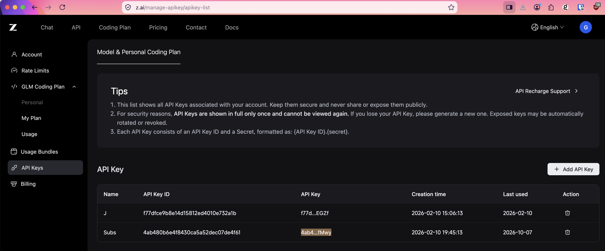

2. **Paste it** into the API key field after choosing Z.AI on the
   `desmosetup` screen, then press **Next**. A provider that only signs
   in launches pi's own login instead.

3. **Model** — pi's model list is fetched, and the report ends with
   "Pi is enabled with zai. Just run `pi`". pi then picks its own model:
   for Z.AI `glm-5.3` at `high` today. To choose another one, do it
   inside pi — the steps are below.

### By hand, inside pi

The screenshots below show `glm-5.3-flash`; pi's own default today is
`glm-5.3`. The steps work for any model.

Run `pi` from terminal (on the VM/container; `./run pi` in local dev).
Freshly provisioned, the TUI is
unconfigured — extensions load, but the warning "No models available…"
and a footer reading `unknown` mean no provider is set up yet:

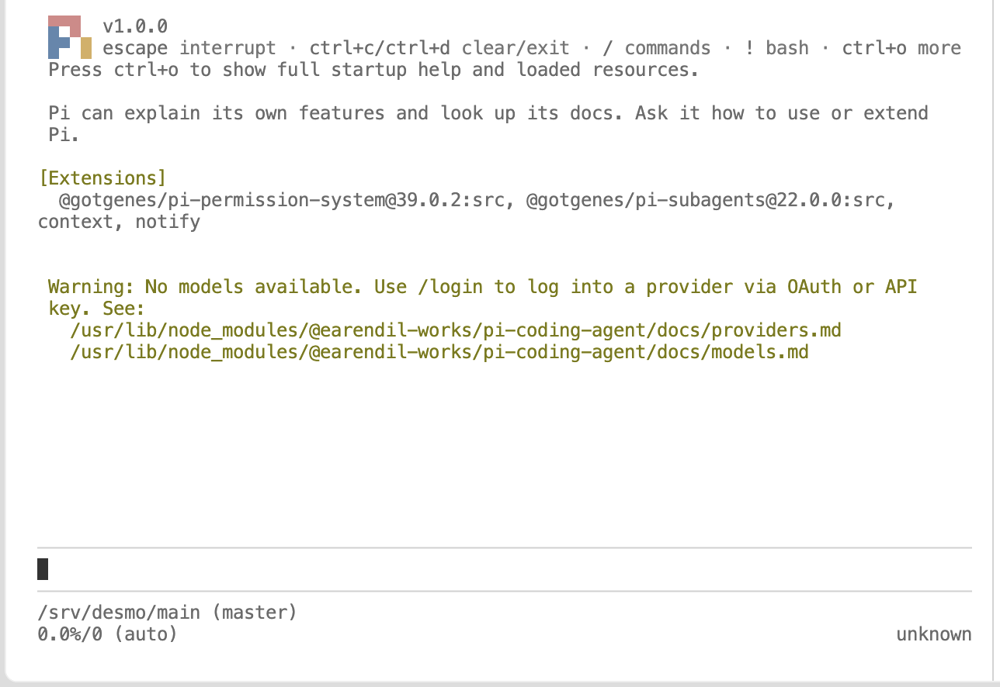

1. **Authenticate**: `/login zai` → paste the key:

   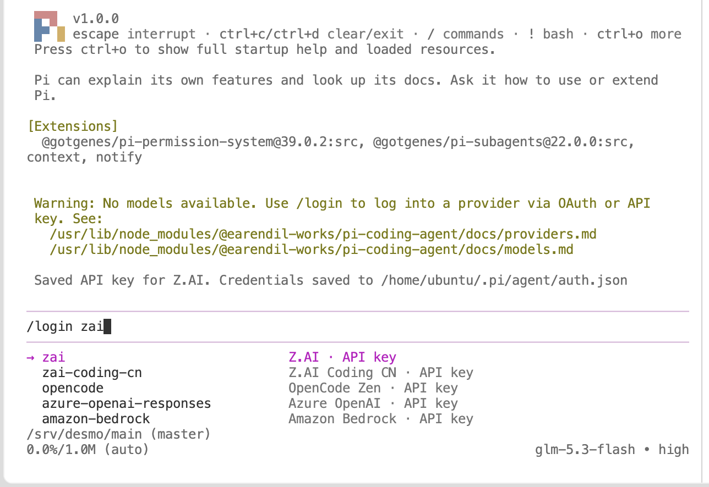

   pi confirms: Saved API key for Z.AI. `Credentials saved to
   /home/debian/.pi/agent/auth.json` (per user; never in the repo or
   the env).

2. **Select model**: type `/model` and type to filter — pick the
   model you want — then **Ctrl+S** on it saves it as the default
   model for new sessions:

    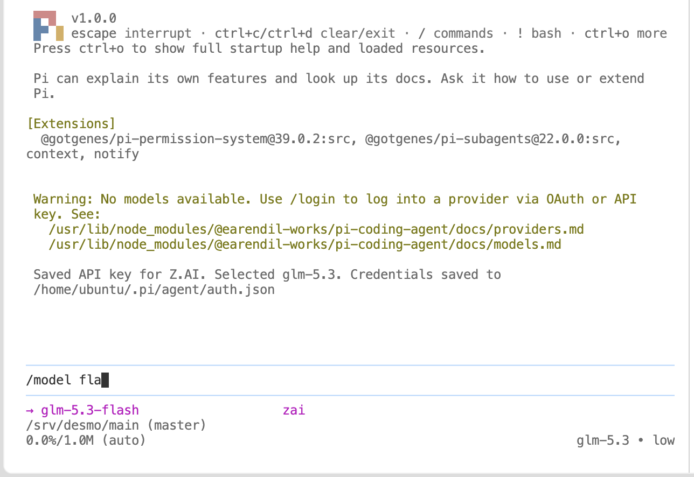

3. **Thinking level**: `/thinking` opens the picker for the current
   model → **high** → **Ctrl+S** sets it as the startup default. On
   Z.AI pi's default level is already **high**; Shift+Tab
   cycles thinking levels in-session, and a one-off override rides
   `pi --model <provider/model>`.

    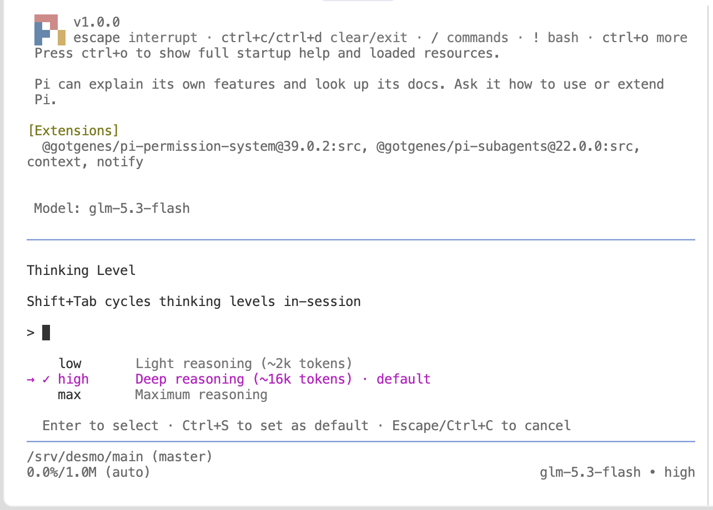

4. **Confirm**: pi prints "Default thinking level: high" and the footer
   line (bottom edge) reads `glm-5.3-flash • high` — the whole setup
   done:

    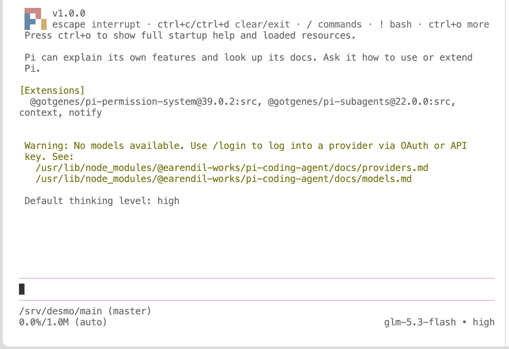

A fresh session orients itself inline — steer.md is injected
automatically and the session reads `.pi/repo-map.md` first; no
background setup agent runs.

## Google OAuth (social login)

On the machine, `desmosetup` stores the credentials: fill **Google
key** and **Google secret** on its screen (see
[First-run setup](#first-run-setup-desmosetup)). The report then prints
the redirect URI to register:

```text
Google login is set
     Authorized redirect URL: https://your.domain/accounts/google/login/callback/
```

Register that redirect URI on the Google app. Both fields left empty
means Google sign-in is not set, and the report names the by-hand
command below:

```text
Google login not set. You may run `cd /srv/desmo/main && ./run djangomanage addoauth google <client_id> <secret>`
```

Credentials live in the database, not in settings or `.env`. The same
storage by hand — from the tree, and the way to change the credentials
later — register the Google app once, after the first `migrate`:

```bash
# leading space should be kept to avoid storing command in bash history
 ./run djangomanage addoauth google <client_id> <secret>
```

This creates (or updates) a `SocialApp` for `provider="google"` linked to the
current `SITE_ID`, with
`scope=["profile","email"]` and
`auth_params={"access_type":"online"}` — the equivalent of the old
`SOCIALACCOUNT_PROVIDERS` block. Re-run it to rotate credentials; no duplicate
row is created. It prints one JSON line: `message`, `redirect_uri` (the
callback to register) and `created`. This is for DEV or any deployment whose hostname Google
accepts — the test VM included, whose setup stores them.
Without Google sign-in, a one-time `makeloginlink` URL gets you in — see
[VM (test server)](#vm-test-server).

Other providers: exactly two lines in `djangoproject/settings.py` are
hardcoded to Google (the `INSTALLED_APPS` provider app and the CSP
`form-action` domain) — the full recipe, plus the signup gate, is in
[docs/social-login.md](docs/social-login.md).

## Sign in (one-time login link)

There is no email/password signup flow (Google login, once configured, is the
only self-serve one) and (in dev) possibly no Google login yet — sign in by
issuing a one-time link for an existing user.

On the machine, `desmosuperuserloginlink` prints the oldest superuser's
name, email and one-time link (24 hours, single use) — and creates
nothing: `desmosetup` created the first superuser. Later superusers are
ignored: the oldest is always the one served (example values):

```console
$ desmosuperuserloginlink
Superuser: Jane Doe (jane@example.com)
Login link — valid 24 hours, single use:

  https://your.domain/login-with-secret/<key>/

Open it in your browser to sign in.
```

With no superuser on the machine, it says how to make one and exits 1:

```console
$ desmosuperuserloginlink
No superuser exists. Create one by hand, then run this again:
  cd /srv/desmo/main && ./run djangomanage createuser <first> <last> <email> --superuser
```

By hand, for any existing user (e.g. one created with `createuser`):

```bash
./run python manage.py makeloginlink alice@example.com
```

Open the printed `/login-with-secret/<key>/` URL once — single use,
60-minute expiry (`--minutes N` to extend, 60 minimum), and only the SHA-256
of the key is stored. Superusers can also issue the same link from a user's
details page (`/users/id/<public_id>` → "Login link"), with 1 h / 8 h / 24 h
TTLs and a copy button.

Session lifetime is **sliding**: a session expires `SESSION_IDLE_DAYS`
after the user's last *successful* request (set in `.env` — required, no
silent default), not after login. `SessionIdleTouchMiddleware`
re-arms the deadline (amortized at half-life; 5xx responses don't extend
it), and huey's daily `clearsessions` purges expired sessions.

## Promote a user to superuser

Social-login users can't be superuser at creation. Promote an existing user by
email (matched case-insensitively; sets both `is_superuser` and `is_staff` so
`/admin` works):

```bash
./run python manage.py promotetosuperuser alice@example.com
```

Once promoted, that user can reach the management routes below.

## The user app (`ourapp/`)

`ourapp/` is a normal Django app (in `INSTALLED_APPS`). It ships with only the
landing page — you add your features there and in its frontend. Features are
split into modules (one per feature), never stuffed into one file:

- **Models** (`ourapp/models/`): one module per feature (`models/<feature>.py`),
  imported in `models/__init__.py` so Django finds them. Each concrete class
  subclasses `djangoapp.models.BaseModel`, which provides `public_id`, audit
  fields (`created_by`, `created_at`, `last_updated_at`, `last_updated_by`) and
  `get_absolute_url()`. Give each a docstring. Add/change a model →
  `./run djangomanage makemigrations ourapp`.
- **API** (`ourapp/views/`): one django-ninja `Router` per feature
  (`views/<feature>.py`); `views/__init__.py` combines them onto one `Router`
  and builds the single API via `make_ninja_api` (error handlers + CSRF guard
  ride along). Page responses render via Inertia
  (`InertiaResponse(request, "<Page>", {"props": …})`), data responses are
  pydantic schemas.
- **URLs** (`ourapp/urls.py`): mounts the ninja API at the project root, so each
  route is served at its literal URL — **including the landing page `/`**, which
  the app owns (the framework serves no home route).
- **Commands** (`ourapp/management/commands/`): seed/setup commands, one module
  per command.
- **Tests**: `ourapp/tests/` — flat, one file per feature + layer
  (`test_<feature>_<layer>.py`; layer = `models`/`views`/`commands`/`playwright`).
  Playwright files are tagged so `./run test` skips them and `./run playwrighttest`
  runs them.
- **Frontend**: one Vue+Inertia app. App code lives under
  `frontend/src/app/` (pages in `app/pages/<Name>.vue`, component name =
  path, e.g. `Home`); framework code lives under `frontend/src/system/`.

The app also has its own `README.md` (a brief feature catalog) and `docs/`
(one markdown file per feature, linked from the README). See
`.pi/steer.md` for the "Checklist — adding or changing a feature".

See `docs/reference/` for a complete copyable example (the **facts** feature —
a `Topic` + `Fact`, a seed command, two pages — and the **todos** feature — a
`Todo` owned by a `User`, one page).

## Models management (superuser)

Mounted under `/manage` (superuser-only; anyone else gets a 404). Lists every
concrete `BaseModel` subclass in `ourapp/` by class name, with its docstring and
browseable rows. A foreign-key cell links to the referenced row via that row's
`get_absolute_url()`.

<figure>
  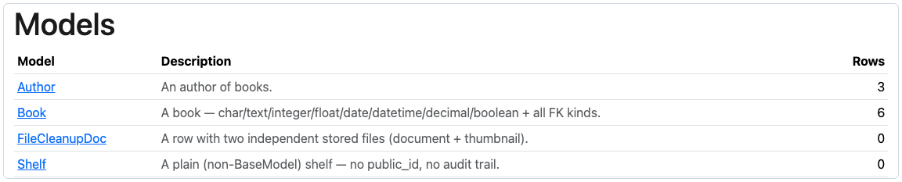
  <figcaption><code>/manage/models</code> — every model with its docstring and row count.</figcaption>
</figure>

<figure>
  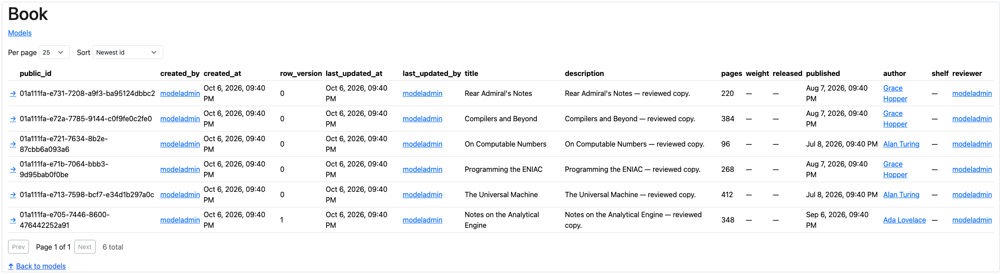
  <figcaption><code>/manage/models/&lt;model&gt;/list</code> — paginated rows, sortable by created/edited.</figcaption>
</figure>

<figure>
  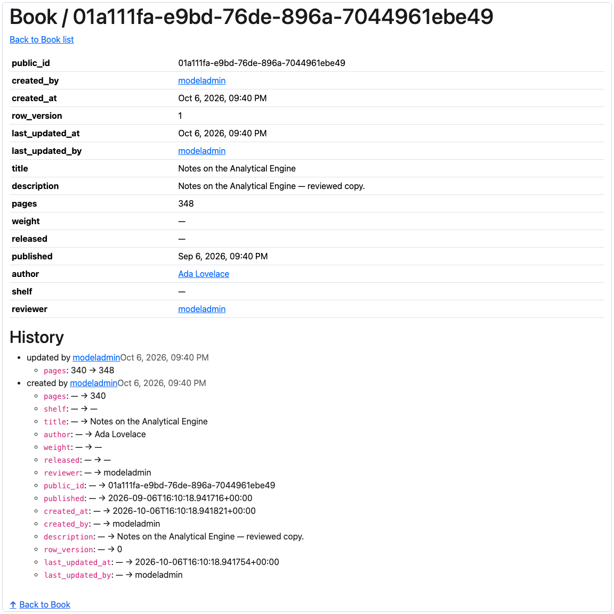
  <figcaption><code>/manage/models/&lt;model&gt;/id/&lt;public_id&gt;</code> — the row's columns and audit log.</figcaption>
</figure>

## Code viewer (superuser)

The navbar's single "Code" link — one surface for reviewing what changed
before a deploy. Both parts are superuser-only (anyone else gets a 404) and
read-only; the git side reads `main` (and `scratch/` when it exists), the
files side browses the repo's parent directory (so `main/…` paths are the
deployed truth) and previews files in-app — rendered markdown, highlighted
code, and images.

### Git viewer

<figure>
  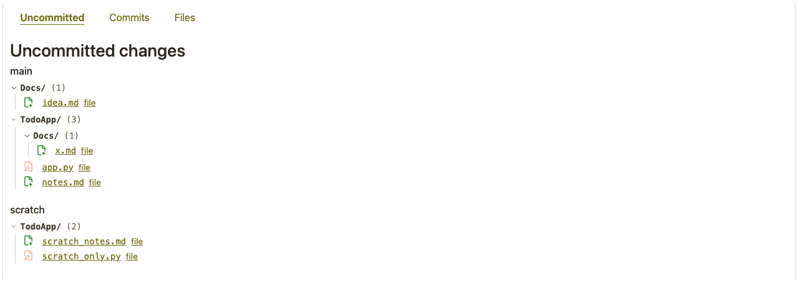
  <figcaption><code>/git/uncommitted</code> — both worktrees' uncommitted files, as folder trees.</figcaption>
</figure>

<figure>
  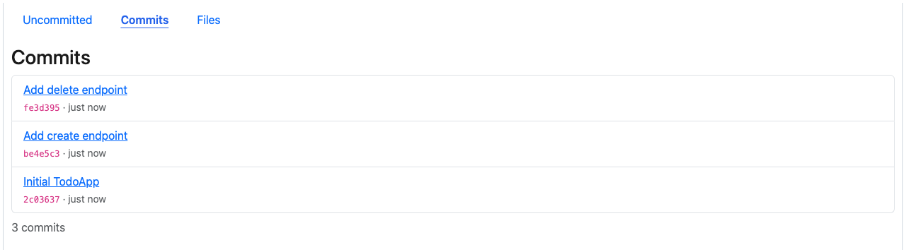
  <figcaption><code>/git/commits</code> — newest-first history; each entry links to its files.</figcaption>
</figure>

<figure>
  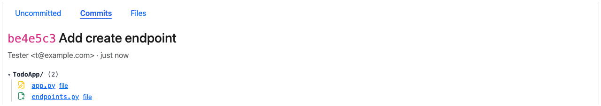
  <figcaption><code>/git/commits/&lt;sha&gt;</code> — the commit's changed files.</figcaption>
</figure>

<figure>
  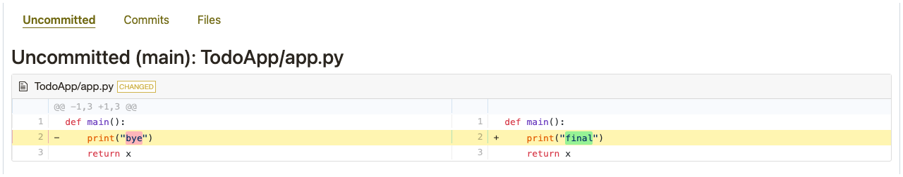
  <figcaption><code>/git/uncommitted/&lt;worktree&gt;/&lt;path&gt;</code> — one file's diff, side by side (same view at <code>/git/commits/&lt;sha&gt;/&lt;path&gt;</code> for committed files).</figcaption>
</figure>

### File browser

<figure>
  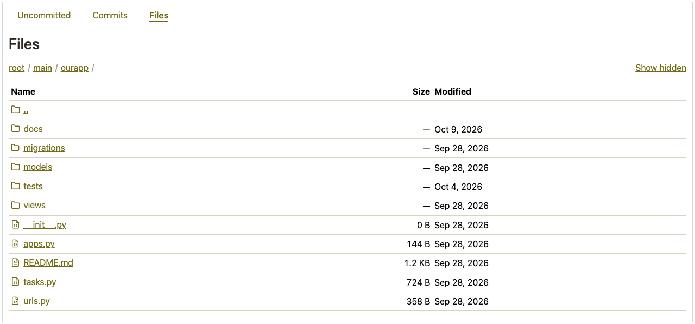
  <figcaption><code>/files/&lt;path&gt;</code> — directory listing with breadcrumb and hidden-entry toggle.</figcaption>
</figure>

<figure>
  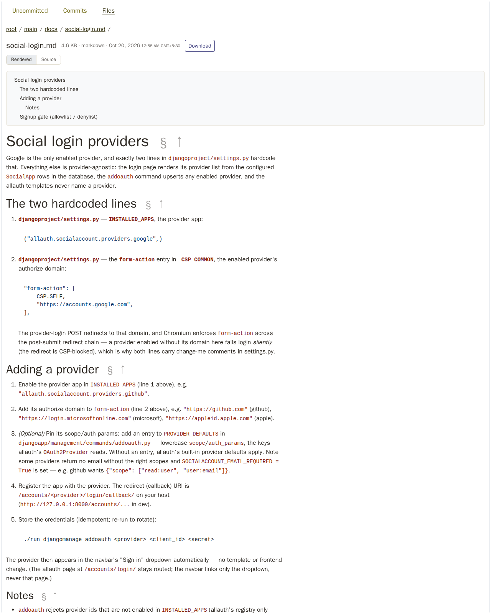
  <figcaption><code>/files/&lt;path&gt;</code> — rendered markdown with its heading outline; d2 diagrams (when present) get zoom controls (+/−/1:1 buttons, ctrl/cmd+wheel, pinch).</figcaption>
</figure>

## Edit → test → deploy workflow

The repo is `main/` (with `.git`); `scratch/` is a throwaway sibling (the
agent reaches it via `../scratch` — pre-approved in agentconfig). For every
change:

1. `./run createscratch` (from `main/`) — copy `main/` (minus caches/build output)
   into a fresh `../scratch/`, sharing `main`'s `.git` (main's HEAD is frozen
   as the `scratch-baseline` ref), and bootstrap its env incrementally
   (`uv sync` + `npm install` over hardlink-copied `.venv`/`node_modules`).
2. Edit `../scratch/` — then review the changes against `main/` in the
   [code viewer](#code-viewer-superuser) (its uncommitted page shows both
   worktrees side by side).
 3. `./run deployscratch` — **run from `main/`, never from scratch's own
    `./run` (it refuses)**. The check battery: ruff + mypy + `ourapp` tests +
    frontend lint/type-check/build (the fast loop: the framework suite and
    Playwright stay in `main/`; frontend/docs-only diffs skip the backend
    battery — lint/build + d2 fence checks only). Must finish green.
    When scratch edits touch framework files (outside `ourapp/` + the app's
    `frontend/src/{pages,components,schemas,styles}/`), it also runs the
    tagged `scratch-test-subset` smoke tests. Run `checkframework1` in
    `main/` for the full gate.
4. the same command's tail — deploy `../scratch/` into `main/` (never
   overwriting `main/.env`; on the VM: backup + migrate + granian/huey
   restart when backend code changed, collectstatic when the bundle
   changed). This does **not** commit.

Mid-build UIs are reviewed as **mockups**: throwaway superuser-only
`/mockup/<page>` routes rendered with a crosshatch overlay, so a design is
visible in the real app before it's built (the convention lives in
`.pi/steer.md`; the repo ships `/mockup/MockupTodos` as the permanent demo —
append `?final=1` for its hatched-off "graduated" look).

<figure>
  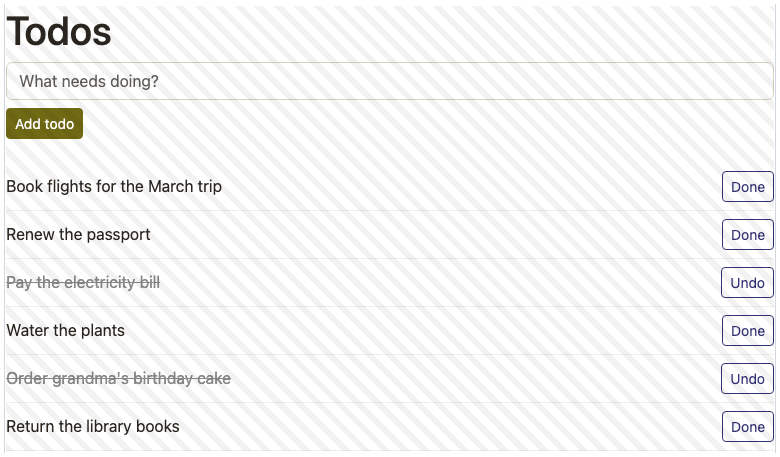
  <figcaption><code>/mockup/MockupTodos</code> — the todos page as a mockup: same markup, crosshatch overlay marks it unfinished.</figcaption>
</figure>

<figure>
  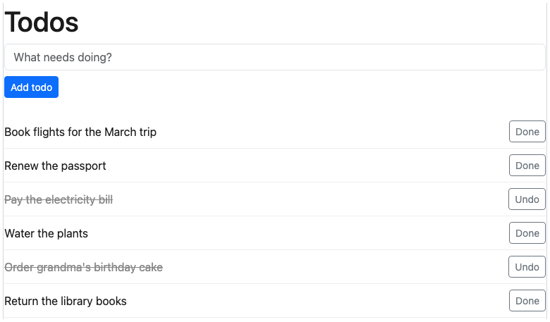
  <figcaption>the finished look it graduates to.</figcaption>
</figure>

In dev the server auto-reloads `main/` after a deploy, so the user sees the
change live. Commit in `main/` as a separate step when ready.

## User management

Users are managed under `/users/` (`djangoapp/views/users.py`). Every management
route requires a superuser; anyone else gets a 404. A user's identity in every
URL and response is `public_id` (a URL-safe UUID7); the integer `pk` is never
sent to clients. Trigram search (`/users/api/search?q=`, similarity across
first/last name + username) backs the list's jump-to-profile box;
`/users/edit/<public_id>` edits, and `/users/history/<public_id>` shows the
audit trail.

<figure>
  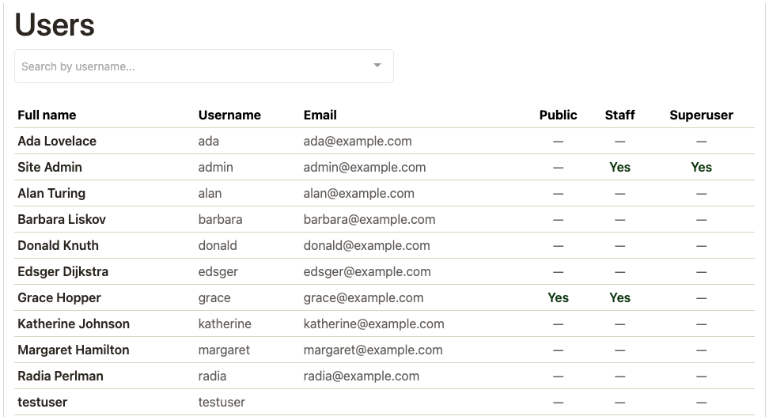
  <figcaption><code>/users/list</code> — paginated roster (25/page) with its jump-to-profile search.</figcaption>
</figure>

<figure>
  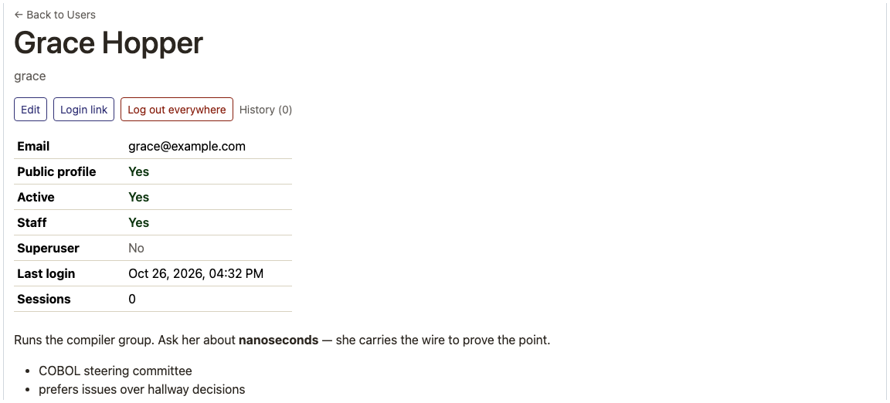
  <figcaption><code>/users/id/&lt;public_id&gt;</code> — profile; superusers get the admin panel (edit, login link, log out everywhere, history).</figcaption>
</figure>

A superuser can't clear their own `is_superuser`/`is_active`, so the active
superuser count can never fall to zero through the UI.

New-account creation is gated by `SocialAccountAdapter.is_open_for_signup`
(`djangoapp/adapters.py`, default: open) —
[docs/social-login.md](docs/social-login.md) has the details and example
allowlist/denylist policies.

## Notifications

Every user's notifications live at `/notifications` (page + API), surfaced by
the unread badge on the navbar's user menu (username + badge; the dropdown
carries Profile / Notifications / Logout). Any view or Huey task records one
with `Notification.record(...)`, which (on commit) enqueues the Web Push
fan-out as its own task — push-service HTTP never runs inline in a request.

- Checkbox selection with bulk Mark read / Delete
- Pagination with 50 rows per page
- filters the list by message kind, via `?kind=`
- Rows are stored till the user deletes
- Browser (Web Push) delivery sends to each logged in browser.

<figure>
  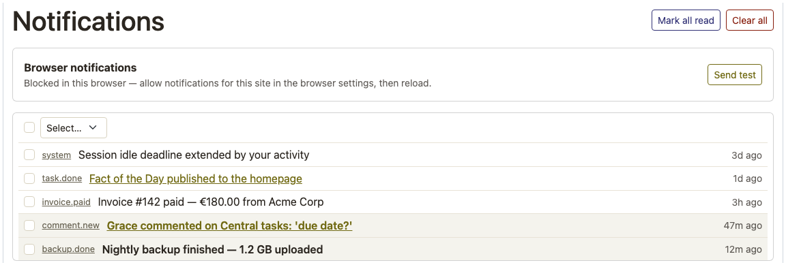
  <figcaption><code>/notifications</code> — the user's list: mark read, delete, clear, and the browser-push card.</figcaption>
</figure>

## Commands

App/dev via the `run` script (test suites + agent on the dev machine; the
web app itself runs only on the VM/container): `init`,
`pi`, the first-run commands — `desmosetup` (domain, first superuser,
Google login, pi provider: one screen, then a report) and
`desmosuperuserloginlink` (a fresh login link) — `test`,
`typecheck`, `lintfix`, `playwrighttest`, `screenshots`, `checkframework1`,
`checkframework2`, `checkmarkdownd2`, `createscratch`, `checkscratch`,
`deployscratch`, `cleanscratch`, `postdeploychecks`, `backupdb`,
`restoredb <set>`,
plus `djangomanage`/`python` passthroughs (e.g.
`./run djangomanage makemigrations`, `./run python manage.py …`).
User/management commands (via the passthrough):
`createuser <first> <last> <email> [--superuser]`, `listusers [--page N] [--superusers]`,
`makeloginlink <email>` (one-time login URL),
`promotetosuperuser <email>`, `addoauth <provider> <client_id> <secret>`
(one JSON line, with the redirect URI to register).

Test-VM lifecycle via `localvm` (root; every command names its instance —
`volatile-test-machine` is checkframework2's disposable one, `desmo` the persistent local one):
`./localvm provision-blank <inst> [--release …]` (launch-only, for the curl|bash install),
`./localvm provision-full <inst> [--repo <url>] [--ref <tag|branch>]` (default:
the local working tree; `--repo` runs the curl|bash for you — published),
`./localvm delete <inst>`, `./localvm shell <inst>`,
`./localvm backup <inst> <message…>` / `rewind <inst> <snap>`,
`./localvm portforward <inst>`,
`./localvm runasdesmo <inst> <cmd…>` (the sanctioned hop for commands
that must run as the desmo user, e.g. file-writing `pg_hardstorage`).


## Logging

The whole app — backend **and** frontend-reported errors — emits one
**JSON object per line** (NDJSON) so the stream is `jq`-filterable. Configure
it once in `djangoapp/logging.py`; `LoggingContextMiddleware` (in
`djangoapp/middleware.py`) binds per-request context.

### Backend

Every logger flows through one structlog `ProcessorFormatter`, so Django's own
loggers (`django.request`/`django.security`), third-party libs (allauth,
ninja, …) and our code all come out with the same shape. Import the logger from
`djangoapp.logging`, never `structlog` directly. Pass key/value fields (not an
f-string) so each line stays `jq`-filterable:

```python
from djangoapp.logging import get_logger

logger = get_logger(__name__)
logger.warning("files fetch failed", path=path, error=str(exc))  # recovered problem
try:
    risky()
except Exception:
    logger.exception("unhandled", method=request.method)  # structured traceback
```

`LoggingContextMiddleware` binds `method`, `path`, `user_public_id`, `username`
onto every line in a request (the integer `pk` is never logged). `exception` is a structured list of stack frames (local variables redacted), not a trailing string.

```bash
jq 'select(.level=="error")'
jq 'select(.logger=="client")'                              # frontend-reported errors
jq 'select(.event=="http request" and .user_public_id=="<id>")'
```

### Frontend errors

Uncaught browser errors are captured globally (`window error`,
`unhandledrejection`, Vue `errorHandler`) by `frontend/src/system/utils/clientError.ts`
and POSTed (async, `await`ed) to `/client-errors`, which logs them on the
**`client`** logger (`source=client`). Each report carries the browser source
location (`client_filename`/`client_lineno`/`client_colno`, resolvable against
the emitted sourcemap), `url`, `user_agent`, Vue's `info` hint, and the
reporter's `public_id`; the backend re-derives the authoritative identity from
`request.user` (never the body) and accepts anonymous reports (`user=null`). A
`navigator.sendBeacon` fallback fires on `pagehide` only while a POST is in
flight, so an error caught right before navigation isn't lost (and isn't re-sent
once delivered). Redis is a hard dependency for the rate limit (an hourly
budget per authenticated user; all anonymous reporters share one bucket):
`REDIS_URL` (required) + `CLIENT_ERROR_RATE_LIMIT` (required, a valid int
above 0; 50 per hour in `.env.example`) drive it, and if redis is unreachable
the endpoint **fails
closed** (500 — the redis error propagates to the global handler) rather than
accepting an unbounded stream.

```bash
jq 'select(.source=="client")'        # every frontend-reported error
jq 'select(.source=="client" and .user_public_id=="<id>")'
```

Sourcemaps are emitted in every build (`vite.config.js` `sourcemap: true`) for
offline/server-side row:col resolution; the serving layer must deny `*.map`
under `/static/djangoapp/` so they never reach clients.

### Searching captured errors

Backend errors, huey failures, and frontend-reported errors are all captured
as NDJSON in the journals (`desmo_granian`, `desmo_huey`) and can be queried with
[miller](https://miller.readthedocs.io) (`mlr`) straight off `journalctl` —
streaming, no intermediate files. Inside the VM:

```bash
# every error for one user — backend AND frontend, both units in one pass
journalctl -u desmo_granian.service -u desmo_huey.service -o cat --since=-1h \
  | grep '^{' \
  | mlr --jsonl filter '$level=="error" || $source=="client"' \
    then filter '$username=="<username>"' \
    then cut -o -f timestamp,source,level,event,client_message
```

Minified frontend stacks (`main-<hash>.js:line:col`) decode back to source
with `frontend/scripts/decode-stack.mjs` against the build's sourcemaps. The
full cookbook — per-origin queries, groupings, decoding, a real sample corpus
in `docs/errors/` — is in [docs/logging.md](docs/logging.md).

## Layout — what the VM (and provisioning) creates

One tree, rooted at `/` of the test VM — everything provisioning
creates/touches. `/srv/desmo/main` is this repo (deploy/install.sh's
clone-built tarball lands it, phase 2). The phase-by-phase version (who
creates what, when) lives in `deploy/inside-vm.sh`'s header.

```text
/                              the test VM — everything provisioning creates/touches
├── etc/
│   ├── credentials/desmo/.env.vm   THE env file — every unit + ./run source it
│   │                               (the tracked deploy/template.env + minted
│   │                               secrets; root:desmo 640)
│   ├── systemd/system/
│   │   ├── desmo_granian.service   web server (ASGI via uv, User=desmo)
│   │   ├── desmo_huey.service      background/cron tasks (User=desmo)
│   │   ├── desmo_pgbackrest.service   nightly DB backup shim (fires
│   │   │                                `./run backupdb` — the logic lives in ./run)
│   │   └── desmo_pgbackrest.timer     fires it 00:00 UTC (Persistent
│   │                                    catch-up after downtime)
│   ├── pgbackrest/pgbackrest.conf  stanza `desmo` → the dbbackups/ repo
│   ├── caddy/
│   │   ├── Caddyfile               stock config + the "import sites/*.caddy" line
│   │   └── sites/desmo.caddy       the app's TLS site — loopback :443 + /static/*
│   ├── redis/redis.conf            stock config + the maxmemory/noeviction block
│   ├── sysctl.d/99-swap.conf       swappiness (with /swapfile + the fstab line)
│   └── profile.d/pi.sh             login notice for debian (from deploy/pi-notice.sh)
├── usr/local/bin/
│   ├── pi                         the agent launcher (baked from deploy/pi.sh —
│   │                               pure delegation to ./run pi; shadows npm's pi)
│   ├── desmosetup,               the first-run commands (installed from deploy/*.sh,
│   │   desmosuperuserloginlink   same delegation: one screen for the domain, superuser,
│   │                             Google, pi + a report; a fresh login link)
│   ├── uv, uvx                    system-wide uv (python envs, on every user's PATH)
│   ├── pgbackrest                 DB backup tool (apt; plain-file repo)
│   └── fd                         symlink → fdfind (Debian's binary name)
├── srv/desmo/
│   ├── main/                      THIS REPO, seeded from the tracked tree (own git
│   │   │                          repo; first commit = provisioned baseline)
│   │   ├── run                    command dispatcher (`./run <cmd>`)
│   │   │                          (`./run help` lists all; no args also prints help)
│   │   ├── djangoproject/         project config, not app logic
│   │   ├── djangoapp/             the reusable framework app (ships with the template)
│   │   │   ├── models/            User/UserHistory/Notification/LoginKey models
│   │   │   ├── views/             users, files, git viewer, notifications, client-errors
│   │   │   ├── management/commands/    users: createuser, listusers,
│   │   │   │                           promotetosuperuser, makeloginlink;
│   │   │   │                           oauth: addoauth;
│   │   │   │                           ops: baseurls, dbstate, generatesdk,
│   │   │   │                           backupmarker
│   │   │   └── templates/ static/      server-rendered shells + built frontend assets
│   │   ├── ourapp/                YOUR app — the one the template exists for
│   │   │   ├── views/             your pages (home page ships as the placeholder)
│   │   │   ├── tasks.py           your huey tasks (one file per feature)
│   │   │   └── urls.py apps.py migrations/ tests/ docs/
│   │   ├── frontend/              Vue 3 + Inertia SPA (vite build → djangoapp/static)
│   │   │   ├── src/main.ts        entry: Inertia + router + push service wiring
│   │   │   ├── src/app/           YOUR tree: pages/ (auto-globbed; component
│   │   │   │                      name = path), components/, styles/
│   │   │   └── src/system/        framework pages/components/schemas/styles/icons/utils
│   │   ├── .pi/                   pi CLI config: permissions allowlist, extensions,
│   │   │                          steer.md + repo-map.md, agents
│   │   ├── deploy/                guest-side scripts (inside-vm.sh, …)
│   │   └── dbbackups/             pgbackrest repo — plain unencrypted backup sets +
│   │                              WAL archive (nightly; runtime data, gitignored +
│   │                              rsync-excluded like media/)
│   └── scratch/                   throwaway agent edit copy (createscratch/deployscratch)
├── usr/local/share/playwright-browsers/
│                                  one shared browser cache for all users (outside
│                                  /srv/desmo: localvm copies .vmcache/ in)
├── var/lib/postgresql/            desmo_db + desmo_db_test (role desmo_user) — the
│                                  databases provisioning creates from the env values
├── home/desmo                     the less-powerful service user's home (runs the units)
└── also on PATH: node 24 LTS (NodeSource apt) + the pi CLI (npm -g) — the operator is
   the default cloud user (debian), member of group desmo, full sudo
```

## Testing

Three tiers:

- **`deployscratch`** — the ONE command, run from `main/` once per edit batch:
  - ruff + mypy over the whole codebase, `ourapp`'s own tests only, and the
    frontend lint/type-check/build — unless the diff is frontend/docs-only,
    which takes the fast path (lint/build + d2 fence checks)
  - skips the framework suite and Playwright (those run in `main/`) — unless
    the edit touches framework files (outside `ourapp/` + `frontend/src/app/`),
    which adds the tagged `scratch-test-subset` smoke tests
- **`checkframework1`** — the full gate, run in `main/`. ruff + mypy + the whole backend
  suite + frontend lint/type-check + Playwright, then two scratch-overlay cycles —
  the **project tier** (test app + `RUN_PROJECT_TESTS=1`: real models/git/files, under
  coverage) and the **reference tier** (`docs/reference/` + its own tests, validated for
  its own sake — not measured). Stages 1-3 run under coverage and merge into one
  `report -m` + `htmlcov/` — the testapp scratch's `djangoapp/` folds onto main's via
  `[tool.coverage.paths]`; the overlay `ourapp/` is exercised but never measured.
  The merged total is ratcheted with --fail-under, fails the gate on any regression — raise it when coverage improves, never lower it.
- **`checkframework2`** — the deployment gate (destructive to its own
  `volatile-test-machine` instance ONLY — every other instance is untouched). The host rebuilds
  `volatile-test-machine` from scratch
  (`./localvm provision-full volatile-test-machine --no-forward` — local tree by default), then runs
  the in-container gate (`ops/checkframework2.py`, run as
  `uv run --no-sync python -m ops.checkframework2`) over one incus exec — the gate's exit code is the verdict. The
  gate:
  - refuses any non-loopback install first (the container's installed `BASE_URLS`:
    a public origin means real data — the battery's testapp overlay, smoke
    superuser, and live-DB restore never touch such a VM)
  - replaces the VM's `ourapp/` with the Books test app
  - smokes the live stack over HTTPS on the VM's loopback (login link →
    session, superuser gates, default-user + `pi`-launcher readiness)
  - runs the agent's full scratch cycle as the default cloud user:
    `createscratch` (with both refusal guards) → marker edit →
    `deployscratch` provably live (marker served after the granian restart) →
    `cleanscratch`

The **test app** (`djangoapp/tests/testapp/`) is a fixture: a complete `ourapp/`
with models exercising every field kind + both FK types, plus the gate's home
and media endpoints. The **reference app** (`docs/reference/`) is the user-facing
example, same format, shipping its own tests. Both are excluded from ruff/mypy
(they're only valid when overlaid onto `ourapp/`).

The README's committed screenshots ([docs/screenshots/](docs/screenshots/)) come
from a fourth, `screenshots`-tagged Playwright pass that self-gates on the
`GENERATE_SCREENSHOTS` env var: `./run test` never collects it (it carries the
`playwright` tag), `./run playwrighttest` collects it as skips, and `./run
screenshots` (which sets the var) runs it. The models-management shots need the
testapp overlay — [docs/screenshots/README.md](docs/screenshots/README.md) has the
recipe.

