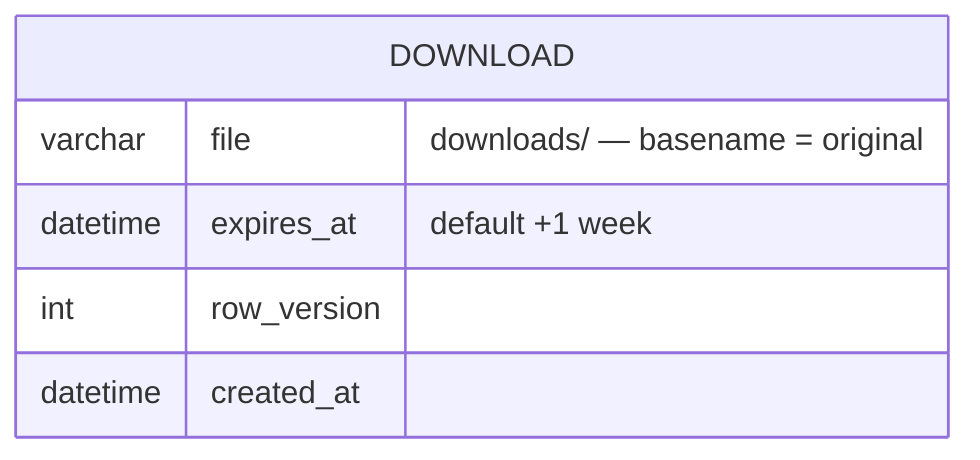
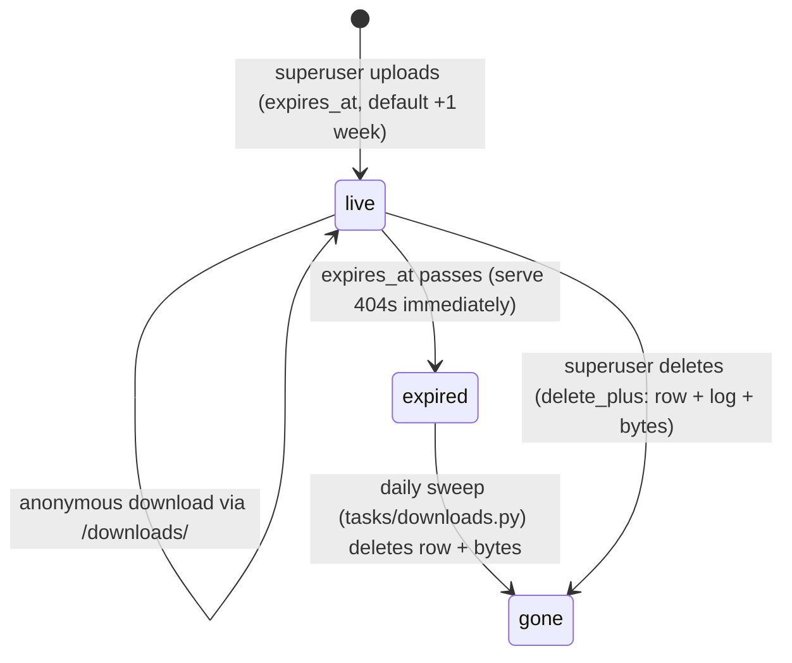
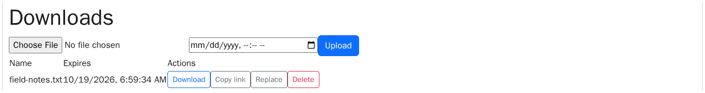

# Downloads

Superuser-uploaded files, anonymously downloadable until an expiry date —
the reference illustration of the framework's media primitives.

## Who can do what

```mermaid
usecase-beta
direction TB
actor Admin("Superuser")
systemBoundary manager["Manager page (/downloads)"]
  Upload("Upload a file")
  Replace("Replace it")
  Delete("Delete it")
end
Admin --> Upload
Replace ..> : extend Upload
Delete ..> : extend Upload
```

```mermaid
usecase-beta
direction TB
actor Guest("Anonymous visitor")
systemBoundary serve["Serve route (/downloads/<storage-name>)"]
  Get("Download a file before its expiry")
end
Guest --> Get
note for Guest "No sign-in to download — expired or unknown names 404 alike."
```

## The data

A **download** is a file plus an expiry: anonymous until `expires_at`,
then gone. One fixed folder (`media/downloads/`); Django's storage picks
the stored name (the original, de-conflicted with a random suffix on
collision — same-name uploads coexist), and the original name is recovered
as the basename.



## How the data changes



- **Upload** — `POST /downloads/upload` (multipart; optional `expires_at`,
  past picks 404).
- **Replace** — `POST /downloads/{public_id}/replace` (multipart swap —
  reassign + `save_plus` deletes the OLD file after commit; a rollback
  keeps the edit and the old file).
- **Delete** — `POST /downloads/{public_id}/delete` (`delete_plus`: row +
  audit log + bytes together — with a bare `.delete()` the bytes stay on
  disk with nothing pointing at them).
- **The sweep** — `tasks/downloads.py` at 3:00 daily (off midnight so
  facts keeps 00:00) removes expired rows + bytes in one transaction.
- A `GET` never changes anything.

## What you see

The manager page (list, upload, replace, delete) for superusers;
anonymous visitors get the serve route only.



## For developers

- Model: `models/downloads.py` (`basename()` recovers the original name;
  `is_expired()`).
- Tasks: `tasks/downloads.py` — the sweep, 3:00 daily (off midnight so
  facts keeps 00:00), one `expired downloads swept` milestone per run.
- View: `views/downloads.py` (manager page + the four routes). The serve
  route is the expiry gate: expired or unknown names 404 alike.
- Serving: Django `FileResponse` for direct requests; for requests that
  arrived through the reverse proxy (detected via `X-Forwarded-For` — only
  Caddy can set it there), an empty `X-Accel-Redirect` hands byte-streaming
  to Caddy (the original name rides along as the disposition).
- Copyists widening upload access beyond superusers: there is no upload
  size or content-type limit today — an accepted risk on an admin-only
  surface, not a pattern to inherit blindly.
