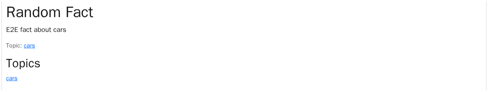

# Facts

Random trivia by topic, plus a daily **Fact of the Day** — a singleton row
the Huey cron rotates each local midnight, shown on the home page.

## Who can do what

```mermaid
usecase-beta
direction TB
actor Visitor("Anyone — no sign-in")
systemBoundary facts["Facts pages"]
  Browse("Browse the list (a fresh draw)")
  PickTopic("Open a topic")
  ReadOne("Read one fact (permalink)")
end
Visitor --> Browse
PickTopic ..> : extend Browse
ReadOne ..> : extend PickTopic
note for Visitor "Open to everyone — facts have no sign-in gate."
```

## The data

A **topic** groups facts ("cars", "science"); a **fact** is one piece of
trivia in that topic. The **Fact of the Day** is a singleton — exactly one
row, DB-enforced — whose `fact` is today's pick.


Reading the diagram: deleting a topic that has facts is refused
(`RESTRICT`); re-seeding facts never wipes the pick (`SET_NULL`). A `GET`
never writes — `FactOfTheDay.current()` is the read-only accessor views
use, and `choose_for_today()` is the only mutator.

## How the data changes

- **The daily rotation.** At local midnight the Huey task
  `choose_fact_of_the_day` calls `choose_for_today()`: pick one random
  fact, upsert the singleton, re-stamp `last_updated_at`. A dead consumer
  shows a stale-but-present fact rather than writing on a `GET`.
- **The seed.** `./run djangomanage seedfacts` creates 10 topics × 20
  facts (audit-logged); `--keep` skips the clear-first step.

## What you see

- The **home page** shows today's pick (or an empty state before the first
  cron run).
- **`/facts`** lists the facts (a fresh random draw per request) with the
  topics to browse.
- **`/facts/<slug>`** shows one topic's fact; **`/fact/<public_id>`** is a
  stable permalink to one fact (deterministic, unlike the random draws).



## For developers

- Model: `models/facts.py`. Methods: `Topic.random_fact()`,
  `Fact.objects.random(topic=…)`, `FactOfTheDay.current()` /
  `choose_for_today()`.
- Cron: `tasks/facts.py` — `@db_periodic_task(crontab(hour=0, minute=0))`.
- Seed: `management/commands/seedfacts.py` (the `FACTS` data is inlined at
  the top).
- Views: `views/facts.py` (`/facts`, `/facts/<slug>`, `/fact/<public_id>`).
- Frontend: `ours/pages/{Home,FactsPage,FactTopicPage,FactPage}.vue`,
  `fact_of_day` on the Home props in `ours/schemas.ts`.
- Tests: `tests/test_facts_{models,views,commands,tasks,playwright}.py`,
  plus `tests/test_home_views.py` (the daily fact on home).
