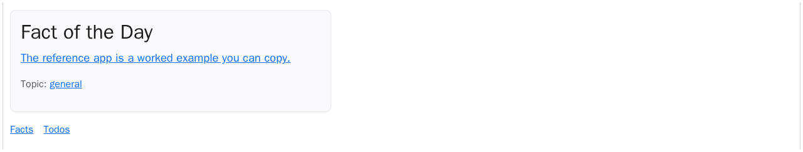

# Home

The landing page — the app's single public route, owned by the app (not
the framework): today's Fact of the Day, the viewer's identity when signed
in, and links to the features.

## Who can do what

```d2
direction: down
visitor: Anonymous visitor {shape: person}
viewer: Signed-in viewer {shape: person}
cron: Huey cron — midnight {shape: person}
home: Home {
  read_pick: Read today's Fact of the Day {shape: oval}
  sign_in: Follow the sign-in link {shape: oval}
  see_identity: See display_name + public_id {shape: oval}
  open_feature: Open a feature link {shape: oval}
}
visitor -> home.read_pick
visitor -> home.open_feature
visitor -> home.sign_in
viewer -> home.see_identity
viewer -> home.open_feature
cron -> home.read_pick
note: A plain sign-in link only — the auth chrome lives in the framework navbar. {shape: text}
```

## Behaviour

- Nothing is stored here and nothing writes — the page only reads. The
  one changing input, today's pick, rotates nightly; see
  [facts.md](facts.md).
- The signed-in state is the shared viewer prop (`user`, injected on every
  page by SharedPropsMiddleware) — the page's own props carry only the fact;
  identity stays pk-free (never the integer pk).

## What you see

Today's Fact of the Day. Anonymous visitors also get a "You are not signed
in." note with a plain sign-in link (the provider buttons live on the
allauth login page). Feature links show only what this viewer can open —
todos, a private feature, stays hidden from signed-out visitors.



## For developers

- View: `views/home.py` (`router`, mounted at `/`) — `GET /` → Inertia
  page `ours/Home`, props `{ fact_of_day }` (`HomePropsSchema` declared
  inline in `Home.vue`; `fact_of_day` is `null` before the first cron run or
  with an empty fact pool). Login state is the shared viewer prop
  (`utils/sharedProps.ts`).
- Frontend: `frontend/src/ours/pages/Home.vue`.
- Tests: `tests/test_home_views.py` (no e2e module of its own — the auth
  chrome lives in the framework navbar, covered by the framework suite);
  the capture is `tests/test_screenshots.py::test_home`.
