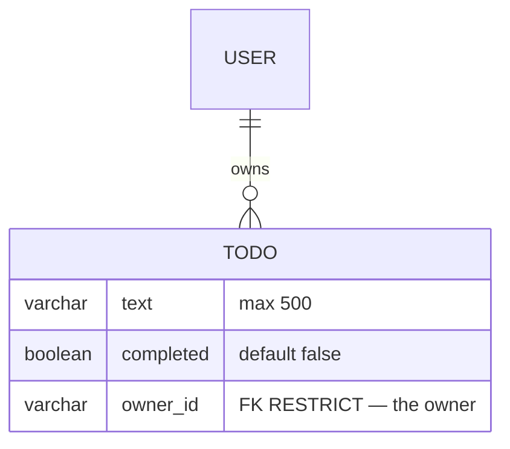
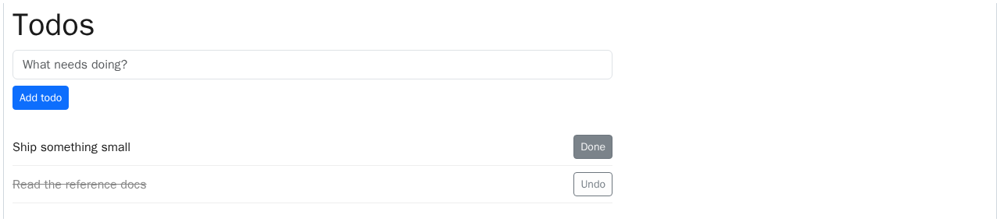

# Todos

A signed-in user's private todo list, on one page: add todos, tick them
off, untick them. Anonymous visitors get a 404 — a private feature never
leaks its existence.

## Who can do what

```mermaid
usecase-beta
direction TB
actor Guest("Anonymous visitor")
actor Member("Signed-in member")
systemBoundary todos["Todos"]
  Add("Add a todo")
  Toggle("Tick it off / untick")
end
Member --> Add
Toggle ..> : extend Add
note for Guest "The page 404s — a private feature never leaks its existence."
```

## The data

One model. A **todo** is the text, a done flag, and its owner:



`Todo.objects.active_for(user)` lists a user's todos, newest first;
`toggle()` flips completion. Deleting the owner is refused (`RESTRICT`).

## How the data changes

- **Add** — `POST /todos/create` with `{ text }` → the todo, newest first.
- **Toggle** — `POST /todos/<public_id>/toggle` → flips `completed`.
  A foreign or missing id → 404 (never another user's row).

## What you see

One page: the add form and the list, with a Toggle button per todo.



## For developers

- Model: `models/todos.py`. Manager: `Todo.objects.active_for(user)`.
  Method: `toggle()`.
- View: `views/todos.py` (the router; all routes under `/todos`).
- Frontend: `ours/pages/TodosPage.vue`, component `TodoForm.vue`, schemas
  in `ours/schemas.ts`.
- Tests: `tests/test_todos_{models,views,playwright}.py`.
