# Nov 4 (VM: Nov 3 23:45Z) chores-tracker session — the deploy-seat session

The same feature, third run — this time under the mid-amended contracts
(the session spanned several tree updates: it started before the
working-notes familiarize and one-pass image rules landed, and ran
through the DocsGate-menu and prompt-free-diagnostic updates). Wall
2:58:20; the coder finished ALL code by ~01:00 and then sat ~55 minutes
blocked on deploys nobody could approve — the dominant cost and the
clearest process bug. It ended with the operator's "you were so slow.
Report why." — the main's own accounting (five points) is assessed
against the pending fixes below.

## Gantt

```mermaid
gantt
    title chores-tracker session - 2h58m wall, elapsed from session start
    dateFormat HH:mm:ss
    axisFormat %H:%M
    section stage 1-2
    mockups and doc draft    :done, m1, 00:00:00, 00:16:26
    diagram cycles 3         :d1, 00:16:26, 00:31:06
    image review one pass    :done, ir, 00:21:33, 00:24:34
    section gate
    PREP hold                :done, prep, 00:32:38, 00:36:09
    section code
    implement after prep pivot steer :active, impl, 00:36:09, 02:13:15
    deploy blockage          :crit, blk, 01:18:05, 02:13:15
    finish without blockage  :milestone, ms1, 02:03:10, 0m
    section review per reviewer
    correctness fam 0m58s    :done, cf, 01:05:39, 01:06:37
    correctness verify 4m26s :done, cv, 02:13:24, 02:17:50
    conventions fam 0m39s    :done, nf, 01:05:39, 01:06:18
    conventions verify 4m15s :done, nv, 02:13:34, 02:17:49
    conventions round2 1m16s :n2, 02:43:40, 02:44:56
    mirrors fam 0m25s        :done, mf, 01:05:39, 01:06:04
    mirrors verify 0m19s     :done, mv, 02:13:52, 02:14:11
    trace fam 0m09s          :done, tf, 01:05:39, 01:05:48
    trace verify 7m35s       :done, tv, 02:13:31, 02:21:06
    trace round2 0m59s       :t2, 02:43:38, 02:44:37
    section tail
    fix resume steer         :fix, 02:23:08, 02:43:23
    screenshot run 1         :s1, 02:38:02, 02:38:37
    screenshot run 2         :s2, 02:41:35, 02:43:00
    deploy fixes round 2     :d2, 02:43:23, 02:44:56
    release and deploy       :done, d3, 02:46:02, 02:46:30
    homepage blank deploy    :done, d4, 02:50:22, 02:53:00
    commit and report        :done, fin, 02:53:47, 02:58:20
```



## Hierarchical time (wall)

```
                                                                  wall  23:49:55→02:48:15
SESSION 2026-11-03T23:45Z (VM clock)                           2:58:20  6 operator turns

├─ 1. mockups + doc draft                                       ~16:30  deploys 23:54 + 00:11
│  └─ operator pick: write docs                                  12:11  the 731s gap
├─ 2. diagram fix cycles ×3                                     ~10:00  "dont iterate" ends it
│  └─ image review — ONE pass                                     3:01  00:11:28→00:14:29
├─ 3. DocsGate + PREP hold                                        1:51  spawn 00:22:33
│  └─ MID-PREP PIVOT steer implement                          00:26:04  new contract, first fire
├─ 4. coder implement                                          1:37:06  00:26→02:03
│  ├─ notify_parent first green                               00:55:34  fleet follows at once
│  ├─ ⚠ DEPLOY BLOCKAGE                                         ~55:00  01:08→02:03 idle
│  │   deployscratch-run typo ×6 asks                           4×300s timeout denies
│  └─ main ships the batches itself                              02:03  unblocked by hand
├─ 5. familiarize fleet ×4 parallel                               0:56  held 67m for verify
├─ 6. verify round (delta resumes)                              ~10:00  02:03:10 ×4
├─ 7. fix resume + screenshots                                   20:15  02:13→02:33
│  ├─ dropped screenshot item                                    02:23  2 extra steers
│  └─ screenshot runs ×2                                        seed bug → recapture
├─ 8. tail: 3 deploys + round-2 verify                            7:00  02:33→02:40
│  └─ "homepage is blank" regression                             02:37  fixed at 02:40
└─ 9. commit + why-report                                         4:45  02:43:42→02:48:15
```

## Phases in detail

- **1. Mockups + doc draft (23:49–00:06).** Fresh session on the
  clean tree; mockup deploy at 23:54, doc draft follows, deploy
  00:11. The 12-minute operator gap after MockupGate links is the
  single biggest operator wait.
- **2. Diagram fix cycles (00:06–00:21).** The doc's data diagram
  went through THREE fix rounds — two chasing the image reviewer's
  vague "realign it" advice, one experiment rendered worse and was
  reverted. The operator's "dont iterate on diagram. Proceed"
  (00:21) ended it. The image reviewer itself ran its one-pass
  contract correctly (single 3:01 verdict).
- **3. DocsGate + PREP (00:22–00:26).** Prep spawned at DocsGate-send
  (old contract — no groundwork wave; that contract landed after
  this session started). Operator approved at 00:24:26; the main
  STEERED the still-running prep with "implement" at 00:26:04 —
  **the mid-prep pivot's first live fire, working as designed**: no
  READY wait, no re-orientation.
- **4. Implement + the blockage (00:26–02:03).** Batches moved fast:
  first green + notify_parent at 00:55:34, familiarize fleet spawned
  the same second. Then the deploy seat broke: the coder ran
  `./run deployscratch run 2>&1 | tail -12` (the steer:50
  "run from main/" ambiguity, relayed through the parent's prose)
  — six permission asks, four killed by the 300s promptTimeoutMs
  while the operator was away (01:08, 01:14, 01:47, 01:53 — the
  5-minute gaps are visible in the coder's own event log, then a
  15-minute hole). All CODE was done ~01:00; the coder sat
  "done but undeployed" until the main noticed and shipped the
  batches itself at 02:03.
- **5–6. Review round (00:55–02:13).** Familiarize ×4 in one
  batched minute, held 67m through the blockage (free). Verify
  resumes at 02:03 used the delta prompt ("files unchanged since
  familiarization are not re-read") — the new verify contract in
  action. Two rounds total: full verify, then a targeted round-2 on
  the fix diff only (02:33). They caught 3 majors + 13 lesser,
  including the "Last completed" fact bug.
- **7. Fix resume + screenshots (02:13–02:33).** Review fixes resumed
  into the held coder. The main DROPPED the screenshot-capture task
  from the fix list, noticed after the coder's report, and paid two
  extra steers (02:23:44, 02:23:53); the first capture set had an
  empty "Created by" row (seed bug) so captures ran twice (02:27,
  02:31).
- **8. Tail (02:33–02:40).** THREE full check-and-deploy cycles in
  seven minutes: review fixes (02:33:18), the release + doc deploy
  (02:36:02), and the "homepage is blank" regression the operator
  caught at 02:37 — fixed with a 3-word CSS class comment and
  deployed again (02:40:17). Each cycle = full battery + restart.
- **9. Close (02:43–02:48).** CommitOffer approved ("1"), the agent
  committed "Add the chores tracker", then the why-report.

## The agent's five, vs the pending fixes

| # | the agent's claim | status against the uncommitted set |
|---|---|---|
| 1 | ~90m coder blocked on deploys | **FIXED (ec0fae4)** — the coder never deploys: every accepted batch pings, the parent owns main/ and ships it; the typo chain (steer:50) is reworded; the `[4]` close is one cycle |
| 2 | 3 diagram cycles where 1 would do | **FIXED** — one-pass image review contracted: stop after fixes + green checkmarkdownd2; re-review only on semantic change; grazing is not a fault |
| 3 | 3 tail deploys should fold into 1 | **FIXED (ec0fae4)** — the [4] close is ONE cycle: one coder resume, one deploy; extra cycles only on operator-reported regressions |
| 4 | dropped screenshot item → 2 round trips; seed bug → double capture | **Partly fixed** — the triage step now ticks every closing item against the fix list; the seed bug itself stays an operational slip |
| 5 | reviewer latency is the intended trade | **Improved (ec0fae4)** — working-notes groundwork contracted: familiarize = store + analyze, verify = delta reconcile; this session predated it |

## Wins (the contracts that fired)

- Mid-prep pivot: approval → steer → batch 1 in 98 seconds, zero
  re-orientation.
- Familiarize fleet: 4 reviewers stored in 56 seconds, held 67m,
  verify on delta prompts.
- Final-green hold → "release" steer: the coder's session survived
  the whole fix round on one context.
- Non-blocking collection throughout (no unbounded get_subagent_result).
- promptTimeoutMs: four clean 300s auto-denies instead of four
  deadlocks — the guard did its job; the asks themselves were the
  typo's fault, not the timeout's.

## Levers (this session's)

1. **Kill the deploy seat problem entirely** — decide between (a)
   allowlisting `./run deployscratch *` so core-loop deploys never
   gate on operator presence, and (b) the agent's redesign: the
   coder never deploys; the main deploys at each batch ping. (b)
   also removes the coder's pre-deploy main/-state checks from the
   critical path. Either way, the 55-minute class dies.
2. **Fold the tail** — one deploy for fixes + doc + screenshots;
   regression fixes justify an extra cycle only when reported.
3. **Fix-list assembly discipline** — the dropped screenshot item is
   the second observed dropped-item round trip; the triage step
   should tick off the [4] checklist items against the fix list
   before resuming the coder.
