# Nov 6 chores session — the generatesdk tool meets its first new consumer

From session `2026-11-06T16-09-53` (16:09:53→17:53:52Z, 103:59 wall): the
chores feature a THIRD time (Nov 2, Nov 3, now), on the fresh provision of
`b0f0930` — first run where the coder's app rides the generatesdk toolchain
shipped Nov 5. One coder session the whole way (groundwork → 3 batches →
fix cycle → geometry pass: 5 resumes, ZERO fresh spawns), fleet of 4
familiarized on batch 1 then held→verify→round-2, image judge ×3 rounds.
Shipped as `bc16cb1` (26 files). Operator: 8 turns ≈ 8:43 + one 5:00 dialog
the operator never saw; main-active ≈ 51 min; main-waiting-on-subagents
≈ 38:51.

## Hierarchical time (wall)

```
                                                               wall
SESSION 16:09:53→17:53:52Z                                   103:59

├─ 1. setup (superuser frank + login link)                     0:27
├─    OPERATOR GAP                                             3:33
├─ 2. mockups: spec → Q&A → 4 files → deploy                  ~6:38  2 pick-turns inside
│     (Home link, list, form+detail mockups; lint+build deploy)
├─    OPERATOR GAP                                             0:50
├─ 3. docs stage (coder groundwork spawned 16:25)              4:57
│  ├─ main writes chores.md + 3 d2 fences                     ~2:04
│  ├─ d2 image judge — CLEAN, 1 nit (label spacing)            1:40
│  └─ nit fix + gate                                           1:13
├─    OPERATOR GAP (gate pick "3")                             1:22
├─ 4. handoff: digest → resume SAME coder                      0:12
├─    OPERATOR GAP ("stop groundwork" — crossed; already       2:24
│     implementing, main confirmed nothing to stop)
├─ 5. main waits coder batch 1 (models+tests+migration)        7:16
├─ 6. deploy batch 1 + fleet spawn + familiarize               9:05
│  ├─ deploy (battery re-runs checks; migration)               2:50
│  └─ familiarize ×4 — batch-1 models ONLY — stored, held:
│     mirrors 3:19 (+14) · correctness 3:26 (+19) ·
│     trace 5:33 (+31) · conventions 6:46 (+24 notes)          6:15
├─ 7. main waits coder batch 2 (views+api+sdk)                14:33  longest silent stretch
├─ 8. batch-2 deploy HALTS on sdk import — operator            2:31
│     authorizes hand-edit in-band ("you may hand edit"),
│     fix + full battery + deploy green
├─ 9. main waits coder batch 3 (pages+e2e+screenshots)        10:37
├─ 10. final green: deploy + retirement of mockups +           3:25
│     fresh diagram renders
├─ 11. verify round — 4 resumed + 1 fresh image judge          7:12  bounded waits ✓
│  ├─ clean: correctness (1 minor) · mirrors (structural
│  │  claim CONFIRMED — see lever 1) · trace (1 minor, 4 nits)
│  ├─ teeth: conventions 2 MAJORS (homepage placeholder block,
│  │  …) · image 1 BLOCKER (garbled labels) + 3 majors
│  └─ parent fixes its own docs meanwhile (home.md,            0:15
│     repo-map §5/§9 — per-feature make_ninja_api)
├─ 12. main waits coder fix cycle (13 items, same session)     6:25
├─ 13. fix deploy + round-2 scoped spot-checks                 3:51  4 confirms, ≤54s each
│  ├─ correctness 2/2 · conventions 8/8 · mirrors ✓ ·
│  │  trace 3/4 — main fixed the 4th itself (root README)
│  └─ image re-view: NOT converged — fence1 reflow regressed
│     (aspect 3.2)
├─ 14. coder geometry pass (prescriptions followed; d2         3:12
│     rejects widths in sql_table — 1 deviation)
├─ 15. MAIN reads the rasters itself, hand-fixes fences ×6     8:09  "I can see the renders
│     (fence1/fence3 labels, pins backfired → revert,                now"; deploy rides in
│      chain routing), deploys doc-only
├─ 16. release coder (session closed) + CommitOffer            0:58
├─    OPERATOR GAP (pick "1")                                  0:34
└─ 17. commit bc16cb1 + close-out (scratch removed;            1:29
       frontend/dist flagged untracked)
```

### Same wall as a mermaid gantt

Sub-minute rounds are floored to 1min so the bars stay visible; the gaps
between a reviewer's bars are its held/idle stretches.

```mermaid
gantt
    title Nov 6 pi session — 103:59 wall (16:09→17:53Z) · durations in each label
    dateFormat HH:mm:ss
    axisFormat %H:%M

    section Main
    pi open (picks) 3m08s            :done, 16:09:53, 188s
    setup frank 27s                  :done, 16:13:01, 60s
    mockups 6m38s                    :done, 16:17:01, 398s
    docs stage + d2 judge 6m12s      :done, 16:24:30, 372s
    handoff resume coder 47s         :done, 16:32:05, 60s
    deploy b1 + fleet spawn 2m50s    :done, 16:42:43, 170s
    b2 deploy halt hand-fix 2m31s    :done, 17:06:21, 151s
    final deploy + renders 3m25s     :done, 17:19:37, 205s
    MAIN raster surgery 8m09s        :done, 17:43:46, 489s
    release + CommitOffer 58s        :done, 17:51:55, 60s
    commit + close 29s               :done, 17:53:23, 60s

    section Main waits coder
    wait batch 1 7m16s               :crit, w1, 16:35:27, 436s
    wait batch 2 14m33s              :crit, w2, 16:51:48, 873s
    wait batch 3 10m37s              :crit, w3, 17:09:00, 637s
    wait fix cycle 6m25s             :crit, w4, 17:30:14, 385s
    wait geometry pass 3m12s         :crit, w5, 17:40:34, 192s

    section Reviewer — mirrors
    familiarize 3m19s (14 notes)     :r1a, 16:44:47, 199s
    verify 2m15s                     :r1b, 17:23:02, 135s
    round-2 10s                      :r1c, 17:37:38, 60s

    section Reviewer — correctness
    familiarize 3m26s (19 notes)     :r2a, 16:44:47, 206s
    verify 2m29s                     :r2b, 17:23:02, 149s
    round-2 12s                      :r2c, 17:37:38, 60s

    section Reviewer — conventions
    familiarize 6m46s (24 notes)     :r3a, 16:44:47, 406s
    verify 4m53s (2 majors)          :r3b, 17:23:02, 293s
    round-2 42s                      :r3c, 17:37:38, 60s

    section Reviewer — trace
    familiarize 5m33s (31 notes)     :r4a, 16:44:47, 333s
    verify 4m16s                     :r4b, 17:23:02, 256s
    round-2 54s                      :r4c, 17:37:38, 60s

    section Image judge
    docs-gate judge 1m40s (clean)    :i1, 16:27:32, 100s
    final verify 4m54s (1 blocker)   :i2, 17:23:02, 294s
    re-view 1m59s (not converged)    :i3, 17:37:38, 119s
```



## Coder anatomy (span 86:18; active 56:24; held 26:31 — 5 holds, all resumed)

| phase | wall | what |
|---|---|---|
| groundwork reads | 3:30 | §9 skeletons, todos exemplar, models; READY + plan, held |
| reconcile digest + style checks | 6:30 | 23k/22k/18k-char GENs: Final-vs-ClassVar, EM/TRY raise style, nullable fields |
| batch 1 write→green | 3:33 | models+registration+tests+migration; 1 wrong self-expectation (Fri pick); mypy clean first pass |
| batch 2 | 21:12 | reads 2:00 · **python3 script-write ask sat 5:00** → edit tool · views+wiring 0:41 · **sdk generator saga 5:01** · tests 4:31 (django-stubs `_MonkeyPatchedWSGIResponse`, 422-before-auth payloads, time_machine scoping) · fences+doc |
| batch 3 | 10:55 | sdk regen **reproduced the import bug** → re-applied operator-approved hand-fix · Home.vue · e2e (2 fixes: z.infer local type, badge text) · 2 PNGs · doc tail |
| fix cycle (13 items) | 7:14 | shared scheduleLabel module, archived read-only note, placeholder removal, networkidle drops, 3 fence rewrites |
| geometry pass | 3:20 | reviewer prescriptions verbatim; 1 documented deviation |
| release | 0:08 | clean close |

## Verify-round breakdown

| reviewer | familiarize | verify | round-2 | verdict |
|---|---|---|---|---|
| mirrors | 3:19 | 2:15 | 0:10 | clean + CONFIRMED generator sees only directly-mounted routers |
| correctness | 3:26 | 2:29 | 0:12 | clean; 1 minor (archived chore renders edit form) |
| conventions | 6:46 | 4:53 | 0:42 | **2 majors** (homepage placeholder, form duplication) |
| trace | 5:33 | 4:16 | 0:54 | clean; 1 minor + 4 nits (stale docstrings/comments) |
| image judge | 1:40 (round-1) | 4:54 | 1:59 + main's own eyes | **1 blocker** + 3 majors → re-fix → still not converged → main took over |

## Permission ledger

**1 ask, and it timed out.** Coder `python3` (script-write attempt, 16:49)
forwarded to the primary and sat **5:00 unanswered → timeout-deny** — the
operator never saw the dialog; the coder fell back to the edit tool (the
write succeeded 41s later). Plus 2 instant deny-with-reason bans, both
correctly redirected with zero stall: `uv run ruff check ourapp/` (17:00)
and `sed -i …` on a test file (17:32). Forwarded total: 1 (Nov 3: 3).

## Wins vs Nov 3 (levers live)

- **Zero fresh coder spawns** — groundwork→implement→fix→geometry all in
  one session across 5 resumes (lever 1 held through everything).
- **Bounded verify collection** (lever 3): verdicts collected in ~2:36 of
  120s waits with triage between; no `get_subagent_result` freeze (Nov 3:
  17:44 blocked).
- **Denial-with-reason bans** (lever 4): both banned commands blocked
  instantly, named their alternative, no 3-5m silent stretches.
- **PREP plan** (lever 8): "implement" resumed straight into a 1:49
  reconcile GEN then batch 1 — no post-steer orientation (Nov 3: ~20m).
- **Reviewer speed contract** (lever 6): round-2 spot-checks 10-54s.
- Mockup + docs stages clean first pass again; deploy-per-batch cadence
  (hold → parent deploys → steer) kept main's tree authoritative.

## Levers

1. **Generator gap A — nested routers are invisible** (5:01 coder saga,
   mirrors-confirmed): `generatesdk` walks only `api._router_registrations`,
   so a feature router combined via `router.add_router("/", chores.router)`
   emitted schemas with ZERO client functions until the coder restructured
   the app's wiring to mount the feature router directly. The app reshaped
   itself around the tool; main then codified that shape into repo-map
   §5/§9 (per-feature `make_ninja_api`). Fix the generator to recurse
   `router.routers` (nested mounts), then decide whether repo-map's new
   per-feature-API prescription stays (it also cuts stack load) or reverts.
2. **Generator gap B — app-tree import off-by-one**: `src/app/schemas/
   chores_sdk.ts` emitted `"../../../system/utils/http"` where two `../`
   is correct — deploy battery's type-check caught it mid-deploy; operator
   authorized a hand edit; the batch-3 regen REPRODUCED the bug and the
   hand-fix had to be re-applied. The committed sdk now can't survive a
   regen. Fix `_SdkGenerator.render`'s hardcoded heuristic to compute the
   relative path (os.path.relpath against the out file), and add a
   regen-idempotence check (regenerate → diff) to the deploy battery so a
   clobbered hand-fix can never deploy silently.
3. **Forwarded asks need an auto-answer**: the one real permission ask of
   the session burned 5:00 of coder wall because it sat on an unwatched
   primary. RESOLVED (same day): `promptTimeoutMs` 300000 → 90000 in the
   permission config — a missed ask now costs 1:30, not 5:00.
4. **Diagram convergence tail ≈ 16 min across both agents**: 1:40 judge →
   fix-cycle rewrites → re-view NOT converged (reflow regressed) → geometry
   pass (1 deviation) → main reading rasters itself and iterating label
   pins/backfired pins/chain routing 6:14. The rules doc taught
   prescriptions but the coder's prescription-following still missed once.
   PARTIALLY RESOLVED (same day): the image reviewer now emits EXACT d2
   patches (reviewer-image.md findings contract) — the docs/d2.md
   anti-pattern list is still open.
5. ~~gitignore `frontend/dist/`~~ RESOLVED differently (same day):
   gitignoring would EXCLUDE dist from the deploy rsync (the exclude
   lists derive from gitignore rules — the bundle rides the deploy).
   Instead `postdeploychecks` excludes `frontend/dist/` from its
   tree-clean check: deploy-generated, rsync-carried, untracked by
   design.
6. Note only: 2 mid-run artifact notifications from the resumed coder
   (stale ask_parent receipts surfacing as pings) — main correctly
   ignored them; worth remembering they're noise, not state.

## Decisions (operator, same day — the next session's contract)

- **Two stages, not three**: Mockups+docs together (one gate, one
  operator pick), then coding. Initial docs carry exactly "Who can do
  what", "The data" (with the d2 fences), "How the data changes" (with
  the fences); every later section ships as a `pending` marker so
  implementation thinking can't start early. The CODER fills the pending
  sections in the batch that implements them.
- **Deploy only to hand the user something**: stage-1 mockups+doc, and
  the final deliverable after review fixes. No per-batch deploys —
  batches run `./run checkscratch` (the deployscratch battery extracted,
  VM-side) between them instead. The deploy's own battery stays (no
  skip flag): if it trips, fix and deploy again.
- **Warm up every agent at stage-1 start**: coder groundwork + fleet
  familiarize on the digest (parallel to mockup authoring); the image
  judge spawns after the mockup deploy. Last session needed ZERO fresh
  spawns after spawn-time (5 coder resumes, 4 reviewer resumes) — holds
  survive; keep it that way.
- **One image verdict, no re-review**: only the image agent judges
  renders, once per artifact set; fixing its comments never re-triggers
  it (the 17:37 re-view loop and the parent-side raster surgery tail die
  here).
- **`@` alias for generated sdks**: tsconfig already maps `@/*`; add the
  vite alias and make generatesdk emit `@/system/utils/http` — kills
  lever 2's import half (the off-by-one class), regen becomes
  idempotent. Lever 1 (nested routers) stays open.
- **Budget failures were feature-query growth, not keepdb debt** (corrects
  the earlier same-day note): the 3 VM-side budget failures are the
  chores feature adding 3 SELECTs (`ourapp_chore` counts) to a shared
  request path vs a frozen budget of 20; TestCase rollback means keepdb
  runs never accumulate rows. The fix belongs to the chores feature in
  the VM repo (bump the budget or defer the summary) — no repo change
  here, and no object-clearing needed.
