# Nov 7 chores session — the new workflow's first run, ended BLOCKED on its own safety guard

From session `2026-11-07T14-14-22` (14:14:22→16:01:55Z, 107:33 wall): chores
(a FOURTH run), on the fresh provision of `4c1fa80` — the first session on
the 2-stage contract (warm-up at stage-1 start, checkscratch between
batches, no mid-feature deploys, one image verdict, final deploy as the
deliverable). The machinery WORKED: one coder session across 6 resumes
(groundwork → 4 batches → screenshots → fix cycle), the fleet familiarized
at 14:17 and resumed 88 minutes later for verify with zero restarts,
image judge ran ONCE (clean, 6:09, no re-review loop). But the session
ENDED BLOCKED: the final deploy refused on the deploy-loss guard — a
false-positive class the guard itself created — and the operator was
absent for both 90s retry windows. Chores sits green in scratch,
undeployed, uncommitted. And the agents spent real time judging OUR
just-shipped code as buggy — analysis below.

## Hierarchical time (wall)

```
                                                               wall
SESSION 14:14:22→16:01:55Z                                    107:33

├─ 1. setup (frank + login link)                                 0:27
├─    OPERATOR GAP                                                0:21
├─ 2. spec + orient + createscratch + WARM-UP ×5 (coder           2:34
│     groundwork + 4 reviewers familiarize — all parallel)
├─ 3. conventions reads (reference, home, scss marker)          ~2:26
├─    OPERATOR ×2 ("why isnt it interacting" /                    2:03
│     "why arent you interacting about the REQUIREMENTS")
│     → main had authored before asking; everything re-held
├─ 4. requirements answers → digest + finish familiarize         2:47
├─ 5. author stage-1 batch (doc + 2 mockups + Home link +       ~0:09
│     scss append) + fence validation                            0:50
├─ 6. UPSTREAM FIX #1 — lintfix flags 5 errors in OUR            0:45
│     committed tests (test_generatesdk / test_postdeploychecks)
├─ 7. presentation deploy #1 — HALTS on OUR type error           0:18
│     (Postdeploychecks.run(None, []) fails mypy)
├─ 8. UPSTREAM FIX #2 (argparse.Namespace()) + redeploy          1:21
├─ 9. collect coder plan + image verdict (bounded waits)         4:38
├─    OPERATOR GAP (gate pick "2")                                2:56
├─ 10. main waits coder batch 1 (models+migration, 2:18          12:06
│     coder-side!) + progress lines
├─ 11. main waits coder batch 2 (views+sdk+tests)               11:43
├─ 12. main waits coder batch 3 (frontend+e2e)                  32:30
│     — includes the 24:10 e2e phantom-bug hunt
├─ 13. main waits coder batch 4 (homepage card)                  6:43
├─ 14. main waits screenshot pass                                4:21
├─ 15. verify round — 4 resumed + main's doc check                8:31
│  ├─ verdicts: no blockers; 2 majors both DOC drift
│  │  (home.md placeholder block; chores.md next_due
│  │  drawn as stored column vs derived) — main fixed both
│  └─ 5 code fixes triaged to the coder (one cycle)
├─ 16. main waits coder fix cycle (all 5, ONE pass)              3:57
├─ 17. FINAL DEPLOY — GUARD REFUSES                              3:57
│  ├─ refusal: 2 mockup pages untracked in main/, not
│  │  pending in scratch (graduation deleted them)
│  ├─ rm workaround → 90s permission timeout ×2                  3:00
│  └─ session ends BLOCKED — deliverable never deployed
└─ 18. blocked close-out message                                  0:13
```

### Same wall as a mermaid gantt

Sub-second floors at 1min; durations in each label.

```mermaid
gantt
    title Nov 7 pi session — 107:33 wall (14:14→16:01Z) · durations in each label
    dateFormat HH:mm:ss
    axisFormat %H:%M

    section Main
    setup 27s                     :done, 14:15:11, 60s
    orient+warm-up spawns 2m34s   :done, 14:16:24, 154s
    conventions reads 2m26s       :done, 14:18:02, 146s
    author stage-1 batch 59s      :done, 14:26:50, 59s
    upstream fix 1 (lint) 45s     :crit, u1, 14:27:40, 60s
    deploy 1 HALT (our type err)  :crit, u2, 14:28:33, 18s
    upstream fix 2 + redeploy 1m21s :crit, 14:28:51, 81s
    collect plan+verdict 4m38s    :done, 14:30:12, 278s
    verify round 8m31s            :done, 15:45:30, 511s
    section Main waits coder
    batch 1 12m06s                :crit, w1, 14:38:07, 726s
    batch 2 11m43s                :crit, w2, 14:50:20, 703s
    batch 3 (e2e hunt) 32m30s     :crit, w3, 15:02:14, 1950s
    batch 4 6m43s                 :crit, w4, 15:34:34, 403s
    screenshots 4m21s             :crit, w5, 15:41:29, 261s
    fix cycle 3m57s               :crit, w6, 15:54:01, 237s
    section Operator
    intervention ×2 2m03s         :op1, 14:20:37, 123s
    requirements answers 1m37s    :op2, 14:22:40, 97s
    gate pick 2m56s               :op3, 14:34:50, 176s
    absent for rm timeouts        :op4, 15:58:17, 180s
    section Reviewers
    familiarize (stage-1 start)   :f1, 14:17:33, 465s
    verify (resumed)              :f2, 15:45:30, 420s
    section Guard
    FINAL DEPLOY BLOCKED 3m57s    :crit, g1, 15:57:58, 237s
```



## Coder anatomy (span 100:10; 6 resumes, ZERO fresh spawns)

| phase | wall | what |
|---|---|---|
| groundwork reads | 8:43 | §9 skeletons, todos reference trio, base.py, users_props — STORED plan, held |
| digest reconcile | 9:37 | two 57k-char GENs (doc absorbed; next_due DERIVED, never stored) |
| batch 1 models | 2:18 | model + tests + migration; 6 lint self-fixes (D401, DTZ001); constraints inverted-logic self-catch; `datetime.UTC` (Django 6 dropped timezone.utc); checkscratch green |
| batch 2 views+sdk | 11:27 | generatesdk `ourapp.views.api` → chores_sdk FIRST TRY (new contract worked); hand chores_props.ts; 23 view tests; 3 test-math self-catches; mypy strict ×2 |
| batch 3 frontend+e2e | 31:52 | pages + form + graduation (mockups deleted); **24:10 e2e phantom hunt** (below); stable ×2 runs |
| batch 4 homepage | 5:30 | card + home regression + home.md |
| screenshots | 3:17 | gated PNG pass wired (`screenshot_dir` ClassVar hook) |
| fix cycle (5 items) | 3:42 | ONE pass, battery green |

## Verify-round breakdown

| reviewer | familiarize | verify | round-2 | verdict |
|---|---|---|---|---|
| correctness | 2:42 | 6:57 | — | clean; month-clamp test settled its math worry |
| conventions | 2:28 | 6:25 | — | 2 majors — BOTH doc drift (home.md placeholder, chores.md next_due) |
| mirrors | 7:42 | 4:23 | — | clean; had to resolve the sdk out-path "canon" itself (§5 example = system/ path; app canon = app/schemas) |
| trace | 8:22 | 4:23 | 0:14 spot | clean; opened 2 lines (TZ labels, archive semantics) → became fixes |
| image judge | 6:09 (ONE run) | — | never | clean + 1 nit; no re-review round — the one-verdict rule held |

## Permission ledger

`psql` on the test DB: instant deny-with-reason → coder pivoted to an
in-tree repro (the redirect worked perfectly). The `rm Mockup*.vue`
workaround: forwarded, sat **90s unanswered ×2** (the new promptTimeoutMs
doing exactly what it was tuned to do — but the operator was gone, so the
correct action died twice and the session with it).

## Why agents judged existing code buggy and confusing

1. **Because it WAS red — we shipped lint and type errors in the last
   commit.** lintfix flagged 5 errors across `test_generatesdk.py` /
   `test_postdeploychecks.py` / `test_scratch.py`, and mypy rejected
   `Postdeploychecks.run(None, [])` — the stage-1 presentation deploy
   HALTED on it; main burned ~2:30 mid-presentation fixing "upstream"
   ("That `run(None, [])` trick predates me but the type checker rejects
   it"). Root cause: my final edits after the last lintfix pull went
   straight into `4c1fa80` without a final lintfix+typecheck pass on the
   exact committed tree.
2. **The sdk out-path canon is two-voiced in repo-map §5.** The example
   shows `frontend/src/system/schemas/users_sdk.ts` (the framework
   feature) while app features canonically emit into
   `frontend/src/app/schemas/` (the reference trio). The coder guessed
   right; the mirrors reviewer still had to "resolve the canon" by
   cross-reading the reference before clearing it.
3. **The e2e phantom made agents suspect the framework itself.** One
   deterministic test bug — `get_by_label("Chore title")` SUBSTRING
   matching the wrong labeled element (old-title payload → 200 no-op →
   "stale" header) — plus ONE never-replayed 500 (`created_by`
   DoesNotExist, observed once, mechanism never established) sent the
   coder through: own math → Vue fill race → server → reading
   **Django 6.1's fetch_modes source** — 24:10 total. Verdict per the
   operator: the 500 was a harness flake (the same module dropped a
   create POST later at 15:44 — the live server hiccups occasionally);
   the correct response is RETRY, not framework archaeology.
   Compounding: lintfix's T201 autofix DELETED its debug prints
   mid-hunt, and piped stdout swallowed them once before that. Real
   salvage: `select_related` fix + `exact=True` labels.
4. **The deploy-loss guard flagged a state IT created** (see lever 1):
   "existing code" (yesterday's guard) refused the final deploy over
   mockup files the stage-1 deploy itself left untracked in main/ and
   graduation correctly deleted from scratch. Main trusted the refusal
   ("the deploy's rsync would lose them" — it wouldn't; rsync --delete
   would have REMOVED them) and reached for rm.

## Wins vs the Nov 6 design

- **Warm-up worked end-to-end**: 5 spawns at stage-1 start, held 78-88
  min, resumed for verify — zero restarts, zero age-outs, the fleet's
  familiarize notes paid off at verify (4-7 min verdicts).
- **One coder session the whole way** (6 resumes); checkscratch between
  batches replaced mid-feature deploys exactly as designed — main/ was
  touched once before the final deploy.
- **Image verdict once, never re-reviewed** — the 17:37-loop class from
  Nov 6 is dead. Diagrams converged with zero parent-side surgery.
- Reviewer speed contract held (verify 4-7 min; spot-check 14s); fix
  cycle ONE pass; both majors were doc drift the round caught cleanly.
- psql deny-with-reason redirected instantly to a better path.

## Levers

1. **Fix the deploy-loss guard's pending-deletion blind spot** (the
   blocker): a main/-dirty file that scratch DELETED (absent from
   scratch's changed-set AND from its baseline) is a carried deletion —
   rsync --delete removes it correctly, yet the guard refuses. Compare
   against the scratch-baseline too, or treat absent-from-baseline as
   carried. Until fixed, every graduating feature ends BLOCKED here.
2. **Never ship red again**: our own commit flow needs the gate we give
   agents — lintfix + typecheck on the exact tree before `git commit`
   (a pre-commit hook running ruff format/check + mypy on staged files
   would have caught all 6 errors in `4c1fa80`).
3. **Repo-map §5 out-path canon**: add "app-tree features generate into
   `frontend/src/app/schemas/` (reference trio); `system/schemas/` is
   the framework-only path" — one line kills the mirrors-reviewer
   archaeology.
4. **E2e debug affordances**: (a) debug prints must survive lintfix
   mid-hunt (T201 autofix deleted them — use `# noqa` or a
   harness-native dump); (b) `get_by_label` defaults to substring —
   teach `exact=True` in the playwright base's docstring; (c) the flake
   rule: a transient that never replays under the same inputs is a
   harness flake — retry once and move on; investigate only when it
   repeats.
5. **Main must ask BEFORE authoring**: the stage-1 rule ("bundle the
   workflow questions into the gate, BEFORE the first mockup") was
   skipped — the operator intervened twice. Make it a MockupDocsGate
   checklist item: "questions asked and answered" before links ship.
6. Note: checkscratch output exceeds the TUI cap — the coder adapted via
   parked-output tails; consider a `--quiet` flag that prints only the
   final banner.
