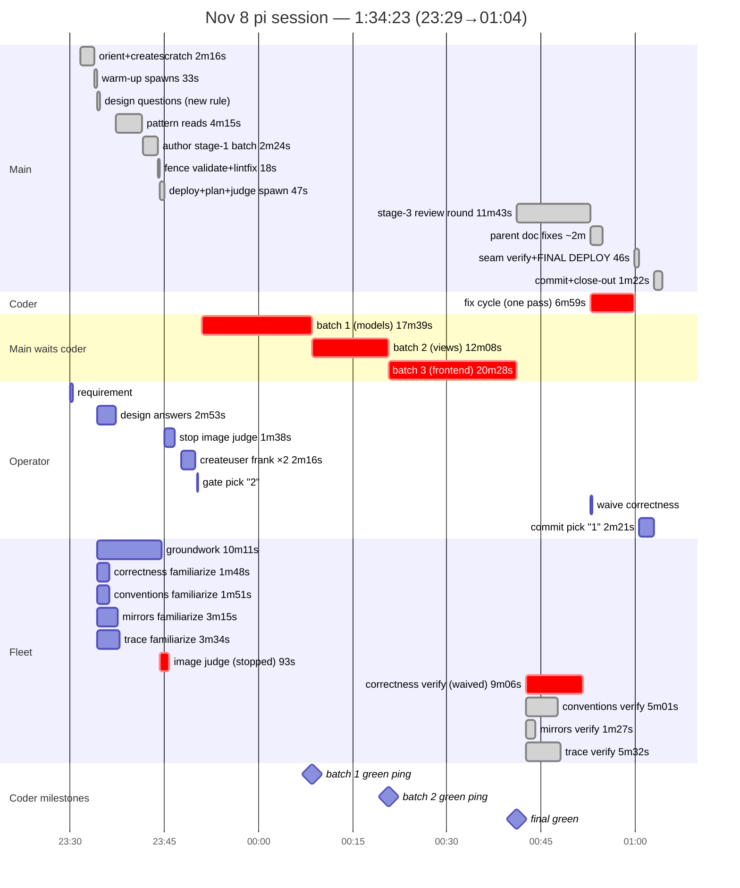

# Nov 8 chores session — the workflow's first end-to-end green run: shipped, committed, closed out in 94 minutes

From session `2026-11-08T23-29-01` (23:29:58→01:04:21, 1:34:23 wall by the
transcript clock — which itself froze ~9h47m mid-session when the host
slept; see lever 1). Chores (a FOURTH run), on the fresh VM provisioned
that evening — first session on the new rules: ask-before-authoring,
terminal gates, no notification-ack noise, no coder batch holds. Every
one of them fired. The session completed ALL five stages — gate approved
on the first try, one fix cycle, final deploy 33s, commit `f999826`
(38 files, +2374), postdeploychecks 3/3, scratch removed — where Nov 7's
ended BLOCKED. Three operator interventions mid-run (skip image verdict,
create a user ×2, waive the slow reviewer) were handled as clean turns.

## Hierarchical time (wall, transcript clock)

```
                                                           wall
SESSION 23:29:58→01:04:21                                 1:34:23

├─ 1. requirement (chore tracker, detailed)                  1:34
├─ 2. orient (repo-map, baseurls) + createscratch            2:16
├─ 3. WARM-UP ×5 (coder groundwork + 4 reviewers             0:33
│     familiarize — all parallel)
├─ 4. DESIGN QUESTIONS — one message, BEFORE authoring       2:53
│     operator: 1a · fixed-day both kinds · summary · two-state
├─ 5. pattern reads (Home, home.py, mockup exemplar,        ~4:15
│     d2.md, home.md, scss marker)
├─ 6. author stage-1 batch (2 mockups + chores.md +          2:24
│     Home links + scss append)
├─ 7. fence validation — scratch's ./run refuses the         0:18
│     verb; main-side retry against ../scratch path ok
│     + lintfix green (149 unchanged)
├─ 8. parallel: image judge spawned + presentation           0:47
│     deploy (FAST PATH, 47s) + coder plan collected
│     (groundwork 611s; interval-due assumption noted)
├─    OPERATOR: "no dont collect image verdict" —            1:38
│     judge stopped (92.8s spent); gate presented
├─    OPERATOR side-quest: createuser frank ×2               2:16
│     (first-user superuser guard → --superuser →
│     duplicate ask → --if-absent + fresh link)
├─    OPERATOR: gate pick "2" — approve                      0:13
├─ 9. coder batch 1 (models+migration+tests) — parent       17:39
│     informed by ping, coder rolled on (no hold)
├─ 10. coder batch 2 (views+urls+wiring+tests)              12:08
├─ 11. coder batch 3 (frontend, homepage graduation,        20:28
│      doc fill-in) — FINAL GREEN → stage 3
├─ 12. review round — fleet resumed (zero fresh spawns)     11:43
│  ├─ delta sized (git diff a4b27e1); main's own
│  │  doc-vs-code spot-check passes
│  ├─ verdicts: conventions clean-of-blockers (5 minors,
│  │  all doc drift); mirrors clean; trace clean (1 nit)
│  ├─ correctness ran 546s+ unfinished — OPERATOR WAIVED it
│  └─ triage: zero blockers, zero majors
├─ 13. fix cycle (coder) + parent doc fixes IN PARALLEL      7:00
│     (both READMEs de-placeholdered, TODO marked shipped)
├─ 14. seam verify + FINAL DEPLOY — full battery, 33s,       0:46
│     migration applied, services restarted — LIVE
├─    OPERATOR GAP (CommitOffer pick "1")                    2:21
├─ 15. commit f999826 (single feature commit)                0:21
├─ 16. postdeploychecks — 2/3 (scratch present; the FAIL
│     names the fix) → cleanscratch → 3/3                    0:49
└─ 17. close-out message                                     0:12
```

### Same wall as a mermaid gantt

Crosses midnight — datetime axis, today-marker off.



## Coder anatomy (one session, 3 batches + fix cycle, ZERO holds)

| phase | wall | what |
|---|---|---|
| groundwork | 10:11 | reference trio + §9 + steering sections; stored plan — baked an interval-due assumption (corrected at approval) |
| batch 1 models | 17:39 | Chore + ChoreInstance, 4 check constraints; lintfix ×3 (DJ001 null-CharField → default "", D401, DTZ001 naive datetimes); scoped tests caught the migration carrying PRE-fix constraints — evidence-first: read the migration, regenerated 0001; 22 tests green; checkscratch 23s |
| batch 2 views | 12:08 | plain views + router wiring + 20 Client tests; self-review fixed `__import__` hack and `_post_json` typing BEFORE linting; lintfix ×2 (FBT001 → keyword-only) |
| batch 3 frontend | 20:28 | ChoresPage + detail, homepage graduation (mockups deleted), doc fill-in, screenshot classes; final green |
| fix cycle | 7:00 | empty-state fix + screenshot suite additions + doc embeds — ONE pass, parent doc fixes in parallel |

## Verify-round breakdown

| reviewer | familiarize | verify | verdict |
|---|---|---|---|
| correctness | 1:48 | 9:06+, UNFINISHED — waived by operator | main had spot-checked its core seams itself (models/views/doc claims) |
| conventions | 1:51 | 5:01 | no blockers/majors; 5 minors — ALL doc-claims drift (README placeholders, missing embeds, TODO bookkeeping) |
| mirrors | 3:15 | 1:27 | clean |
| trace | 3:34 | 5:32 | clean, 1 trivial nit |
| image judge | — | 92.8s, STOPPED at operator request | verdict never collected — operator's eyes were the check |

## Operator interaction ledger

Eight turns, all honored, zero main-initiated noise: requirement → design
answers (2:53 — the ask-before-authoring round) → "no dont collect image
verdict" → createuser ×2 (second one a literal repeat; handled via
`--if-absent`) → gate pick "2" → "correctness can stop" → commit pick "1".
The gate stood untouched through all side quests.

## What the new rules proved (Nov 7 levers → this session)

- **Ask-before-authoring worked** (Nov 7 lever 5): questions at 23:34,
  authoring at 23:41, four decisions frozen before a line of mockup
  existed. Gate approved FIRST TRY — zero revision loops (Nov 7: author
  first, operator intervened twice, everything re-held).
- **Gate terminality worked**: zero main-initiated messages after the
  gate. Side quests were operator turns, answered, gate untouched.
- **Batch holds are dead**: two green pings informed; the coder rolled
  straight on both times; only final green held for review.
- **The deploy-loss guard blind spot stayed dead** (fixed this morning +
  matrix-verified): graduation deletions rode the final deploy without
  ceremony.
- **Evidence-first held**: the constraint/migration mismatch was
  diagnosed by reading the migration before regenerating — one fix, no
  blind loops, no flakes.
- **Warm-up fleet**: five spawns, resumed for verify with zero fresh
  spawns; stored notes cited in verdicts (87-332s each).
- **Fast-path classification**: presentation deploy 47s (docs/frontend
  only); final deploy 33s WITH full battery + migration + restarts.

## TODO questions answered from this session's evidence

- **When should the coder background agent launch?** Keep groundwork at
  stage-1 start — its 10 minutes of reading overlap the design-question
  round productively. The one cost: its plan baked the digest's
  interval-due reading; the answers landed 2:53 after spawn and were NOT
  forwarded, so the correction waited for approval. Fix is lever 3, not
  a later launch.
- **Launch reviewer background agents later (visual clutter)?** The four
  text reviewers earned their keep — verify verdicts in 87-332s from
  stored notes. The WASTED spawn was the image judge (92.8s, stopped,
  verdict never wanted). Make the image verdict opt-in instead of
  delaying the fleet.
- **Kept in the dark / post-gate noise** — both resolved and evidenced
  here: one question round before authoring; zero messages after asks.

## Levers

1. **Enable NTP in the provisioner**: the VM clock froze ~9h47m when the
   host slept (multipass pauses the VM; `systemd-timesyncd` is not
   enabled). Skews audit stamps, huey crontabs, and token windows — the
   "60 minute" login link minted mid-session was real-time-valid for
   ~10h45m. One `systemctl enable --now systemd-timesyncd` in
   `deploy/inside-vm.sh`.
2. **Image verdict becomes opt-in**: asked as a gate menu item (or
   skipped on request) instead of spawned unconditionally — today's
   judge burned 92.8s before the operator stopped it.
3. **Forward design answers to the running groundwork**: when the
   question round resolves, steer the groundwork mid-flight with the
   frozen decisions — kills assumption-corrections at approval time.
4. **checkmarkdownd2 verb from scratch's ./run refuses** (guided retry
   to main cost 6s): either forward the verb or note the main-side
   invocation in steer's validation step.
5. **Reviewer wait ladder**: two bounded waits (~5:30) on a reviewer the
   operator then waived — a "waive and continue" option in the collect
   loop (or a single wait before asking) would cut the dead time; main
   had already covered the seams itself.
6. **The e2e tier went missing**: shipped tests are 42 Django-Client
   view/model tests + the screenshot pass (real browser, but happy-path
   captures) — no chores playwright e2e module, and nothing flagged it
   (the reviewer who would have was waived). Batch plans and the review
   checklist should pin the e2e module per feature.

## Wins vs the Nov 7 run

- First COMPLETE run: all five stages green, deliverable deployed AND
  committed AND closed out (Nov 7: BLOCKED at the final deploy).
- 1:34:23 wall vs 107:33 — with eight operator turns honored instead of
  two complaints.
- Zero upstream red: the seed tree was clean, so no mid-feature
  "someone else's bug" fixes (Nov 7 burned ~2:30 on our shipped lint/type
  errors).
- Both doc-drift classes Nov 7 found were pre-empted by the parent's
  spot-check + parallel doc fixes during the fix cycle.
