# Nov 9 chores session — first run on the new rules: 70 minutes, every rule held

From session `2026-11-09T18-35-27` (18:37:32→19:47:44 requirement to
close-out = 1:10:12; full session 18:36:25→~19:57 ≈ 1:20 with two
post-ship operator investigations). Chores, run THREE — and the first
feature on the Nov 9 workflow rules (coder `thinking: low`, reviewer
fleet at first green batch, image judge at coding launch). Result: same
feature as Nov 8, ~25% faster wall with an EXTRA unplanned cycle
(placeholder removal) inside it, zero waived reviewers, and the close-out
ended with the three links. Two operator corrections mid-run (one caught
a real steer bug — see lever 1), one operator false-alarm (data loss)
resolved with evidence in three minutes.

## Hierarchical time (UTC session clock)

```
                                                          wall
SESSION 18:36:25→~19:57:00                               ~1:20:00

├─ 0. side quest: createuser frank (superuser guard        0:31
│     → guided retry, link minted)
├─ 1. requirement (chore tracker, detailed)                 0:00
├─ 2. orient (repo-map + coder.md, ONE batched read)        1:30
├─ 3. createscratch + coder GROUNDWORK spawn (ONLY          0:44
│     the coder — new rule; no reviewer clutter at start)
│     groundwork DONE in 65.6s, plan banked, HOLDS
├─ 4. DESIGN QUESTIONS — one message, four choices         (0:20
│     to compose; operator answers in 1:25)
├─ 5. pattern reads (mockup exemplar, Home, scss,           3:19
│     reference docs — batched)
├─ 6. author stage-1 batch (2 mockups + chores.md +         2:59
│     scss append, four d2 fences)
├─ 7. fence validation — scratch ./run refuses the          0:49
│     verb AGAIN; main-side retry ok
│     └─ main eyeballed the 4 PNG renders — OPERATOR
│        CORRECTION: "main agent shouldnt inspect image"
├─ 8. d2 fixes from the (code-level) self-check ×5 +        3:07
│     revalidate green
├─ 9. presentation deploy — prettier trip → lintfix →       0:43
│     re-deploy green (fast path both times)
├─    OPERATOR: "did coder agent finish too soon?" —        0:00
│     answered: groundwork holds by design (new-rule
│     onboarding moment)
├─    OPERATOR: gate pick "2" (1:29 gap)                     0:00
├─ 10. TWO LAUNCHES at approval (new rule): coder           —
│      resume + image judge spawn, together
│  ├─ judge verdict 5:58 in: 2 fences clean, 2 exact-
│  │  edit nits → STEERED to coder mid-run (new rule's
│  │  designed loop, closed)
│  ├─ coder batch 1 GREEN (7:52; 27 tests) → ping
│  ├─ REVIEWER FLEET familiarizes NOW (new rule), on       ~5:00
│  │  the requirement + the batch-1 diff; notes stored
│  │  (23/17/22/+conventions), all hold
│  ├─ coder batch 2 GREEN (40 tests) → ping, continues     5:48
│  └─ FINAL GREEN — implement span 23:45 (was ~40 min
│     of batches on Nov 8's high-thinking coder)
├─ 11. verify: fleet resumed ×4 + MAIN runs the e2e         6:16
│      itself (evidence-first): 2F+1E triaged to THREE
│      TEST bugs (strict-mode substring, time-travel
│      fixture, parked-page 404) — product clean
├─ 12. verdicts (parallel, none waived; ~4:00 each):        0:12
│      triage 2 majors (impossible e2e fixture — two
│      reviewers independently; pending doc section)
├─ 13. fix cycle (coder) ∥ parent doc fixes (home.md       5:50
│      stale claims + README entry) — parallel
├─ 14. parent e2e re-run: 1 left → SOLO-RUN probe →        5:29
│      root cause: framework UserMenu partial-reload on
│      the parked page re-requests with wiped cookies;
│      steer refused (coder completed) → fresh resume
│      fallback (50.5s) applies the fix
├─ 15. FINAL DEPLOY — full battery + 2 migrations +         0:39
│      restarts; coder RELEASED
├─    CommitOffer → OPERATOR: "remove the placeholder       7:24
│      you idiot" → mini-cycle: framework e2e pins
│      checked, scaffolding stripped (Home.vue + home.md
│      + README), lintfix + checkscratch, ONE tight
│      reviewer pass (96.8s, clean), deploy (1:55)
├─    OPERATOR: pick "1" → single commit 95a2e86            0:37
│      (24 files, +2153/−73) → cleanscratch →
│      postdeploychecks 3/3 → close-out ENDING WITH
│      THE THREE LINKS (page / doc / commit) — new rule
├─ 16. post-ship: OPERATOR data-loss alarm ("my chore       ~3:30
│      vanished") → evidence: journalctl shows both
│      creates hit live app; DB rows queried: both present
│      — one archived by the operator 8s after creation
│      (it's under the Archived filter); the "~0 rows"
│      earlier was a stale PG estimate
└─ 17. lintfix-policy question answered; session ends
```

### Same wall as a mermaid gantt

Elapsed from session start (00:00 = 18:36:25 UTC); milestones across the
top anchor the timeline (mermaid gantt cannot draw vertical dotted
rules).

```mermaid
%%{init: {"gantt": {"todayMarker": "off"}} }%%
gantt
    title Nov 9 pi session — 1:10:12 requirement→close-out, elapsed axis
    dateFormat HH:mm:ss
    axisFormat %H:%M

    section Milestones
    judge verdict steered :milestone, 00:24:10, 1s
    batch 1 green :milestone, 00:25:04, 1s
    batch 2 green :milestone, 00:30:52, 1s
    final green :milestone, 00:41:33, 1s
    commit 95a2e86 :milestone, 01:10:42, 1s

    section Main
    orient 1m30s :done, 00:01:07, 90s
    design questions :done, 00:03:21, 20s
    pattern reads 3m19s :done, 00:04:46, 199s
    author stage-1 2m59s :done, 00:08:05, 179s
    validate + image correction 3m56s :done, 00:11:04, 236s
    presentation deploy 43s :done, 00:15:00, 43s
    e2e triage 6m16s :done, 00:43:07, 376s
    verdict collect + triage 12s :done, 00:49:23, 12s
    parent doc fixes 41s :done, 00:50:32, 41s
    e2e re-run + park-page fix 5m29s :done, 00:55:25, 329s
    FINAL DEPLOY 39s :done, 01:00:54, 39s
    placeholder mini-cycle 7m24s :done, 01:02:36, 444s
    commit + close-out 37s :done, 01:10:42, 37s
    data-loss audit 3m30s :done, 01:16:35, 210s

    section Main waits coder
    implement (batches 1-3) 23m45s :crit, 00:17:12, 1425s
    fix cycle 5m50s :crit, 00:48:55, 350s

    section Operator
    createuser frank :op1, 00:00:00, 31s
    design answers 1m25s :op2, 00:03:21, 85s
    coder too soon? :op3, 00:09:55, 30s
    no image inspection :op4, 00:13:11, 30s
    gate pick "2" :op5, 00:15:43, 89s
    remove placeholder :op6, 01:01:52, 44s
    commit pick "1" :op7, 01:09:40, 42s
    data-loss alarm :op8, 01:16:35, 30s

    section Fleet
    groundwork 66s :f1, 00:02:37, 66s
    image judge 5m58s :f2, 00:17:48, 348s
    correctness familiarize 3m09s :f3, 00:26:00, 189s
    mirrors familiarize 3m55s :f4, 00:26:00, 235s
    trace familiarize 4m30s :f5, 00:26:00, 270s
    conventions familiarize 5m17s :f6, 00:26:00, 317s
    correctness verify 4m03s :done, 00:41:49, 243s
    conventions verify 3m55s :done, 00:41:49, 235s
    mirrors verify 4m04s :done, 00:41:49, 244s
    trace verify 3m51s :done, 00:41:49, 231s
    park-page fix 50s :f7, 00:59:48, 51s
    tight reviewer 97s :f8, 01:06:28, 97s
```



## The fleet (one coder session + five reviewer sessions, none waived)

| agent | span | tokens | what |
|---|---|---|---|
| coder (groundwork) | 65.6s, 8 uses | 18.0k | reads + plan banked, held — **vs 10:11 on Nov 8** |
| coder (implement) | 23:45, 154 uses | 159.6k | 3 batches, 44 tests, mockups graduated |
| coder (fix cycle + park fix + release) | ~7:10 | +37.7k | reviewer fixes, harness fix, sign-off |
| image judge | 5:58, 7 uses | 42.2k | 2 clean fences, 2 exact-edit nits — steered mid-run |
| reviewer-correctness | fam ~3:09 → verify 4:03 | 70.4k | caught the impossible e2e fixture |
| reviewer-conventions | fam ~5:17 → verify 3:55 | 92.4k | doc-claims drift + the same fixture |
| reviewer-mirrors | fam ~3:55 → verify 4:04 | 76.0k | clean of blockers |
| reviewer-trace | fam ~4:30 → verify 3:51 | 79.1k | clean of blockers |
| single reviewer (placeholder) | 1:37, 9 uses | 14.2k | tight scope, clean |

Coder totals: ~32 minutes, 197.3k tokens — **Nov 8's coder: ~68
minutes, 292k** (same feature, high thinking). Requirement→close-out
1:10:12 vs 1:34:23, and the Nov 9 number CONTAINS the unplanned
placeholder cycle.

## Operator interaction ledger

Ten turns: side quest (createuser) → requirement → design answers (1:25)
→ "did coder agent finish too soon?" (answered: groundwork holds by
design) → "main agent shouldnt inspect image" (correction accepted,
steer bug exposed) → gate "2" → "remove the placeholder you idiot"
(handled as a scoped mini-cycle: pins checked → strip → battery → one
tight review → deploy) → commit "1" → data-loss alarm (answered with
journalctl + live DB rows; the chore was archived by the operator 8
seconds after creating it) → lintfix-policy question. Zero
main-initiated noise; the gate and the CommitOffer each stood untouched
through side traffic.

## What the new rules proved (first run on the Nov 9 rules)

- **Coder at low thinking**: groundwork 66s vs 10:11; whole
  implementation 23:45 vs ~40 min; tokens −33%. The "many cheap turns"
  bet paid exactly as profiled.
- **Fleet at first green batch**: no stage-1 clutter (one agent visible
  until 19:01); familiarize ran WITH the batch-1 diff in hand; verify
  verdicts 3:51-4:04 each, NONE waived (Nov 8: one waived at 9:06+).
- **Image judge at coding launch**: verdict at 5:58, exact d2 edits,
  steered into the running coder — the designed correction loop closed
  end to end.
- **Ask before authoring**: four frozen decisions, gate approved first
  try, zero revision loops — second session running.
- **Terminal asks / no ack noise**: held across ten operator turns.
- **Close-out shape**: ended with the three links (page, doc, commit)
  in exact `[label](<url>)` form; the doc's captures carried captions.
- **Evidence-first, twice**: the e2e triage (read → solo-run isolation
  → root cause; all three failures were TEST bugs) and the data-loss
  audit (journalctl → live rows → stale-estimate debunk) were both
  textbook — no theorizing before evidence.

## Levers

1. **Steer told main to eyeball renders** — the Diagrams section's
   "Render and self-check BEFORE the first deploy — look at them
   yourself" is what main obeyed at 18:48; the operator's correction
   ("main agent shouldnt inspect image") is the actual policy. Fix the
   Diagrams bullet: the pre-deploy self-check is STRUCTURAL
   (`checkmarkdownd2` + reading the d2 source); pixels belong to the
   image judge and the operator's eyes, never main's.
2. **checkmarkdownd2 refuses from scratch's ./run — second consecutive
   session hit** (~10s + one turn each time, self-explaining refusal).
   Either route the verb through from scratch's run or note the
   main-side invocation in the authoring rules; the friction is now a
   pattern, not an accident.
3. **Parked-page e2e isolation bug**: the framework `UserMenu`'s
   visibilitychange partial-reload fires on the shared page parked
   between e2e tests, re-requesting `/chores` with wiped cookies →
   console 404 → the strict harness fails the NEXT test. The base
   harness should park on a neutral page (or drop cookies before
   parking) — a one-line framework fix in `_base.py` that removes a
   whole class of cross-test phantom failures.
4. **dbstate's "~0 rows" is a stale PostgreSQL estimate** and it nearly
   anchored the data-loss answer the wrong way ("your table is empty");
   only the live query corrected it. `dbstate` should count small
   tables for real, or stamp every estimate with a caution.
5. **Steer-after-complete**: the park-page fix hit "cannot steer a
   non-running agent" (the coder completed after its fix-cycle green
   instead of holding). The fresh-resume fallback worked (50.5s), but
   the coder contract could hold-for-release after every fix cycle the
   way it holds at final green.

## Wins vs the Nov 8 run

- Same feature, 1:10:12 vs 1:34:23 — with an extra unplanned cycle
  (placeholder removal) and zero waived reviewers inside the faster
  wall.
- One commit (24 files, +2153/−73) vs 38/+2374 — tighter scope, no
  screenshot-suite overhang.
- Every workflow rule from the Nov 9 tuning fired as designed, first
  try, no operator noise complaints.
- Two operator corrections were absorbed mid-run without breaking the
  stage machine (one exposed a real steer bug — lever 1).
