# Nov 10 chores session — the browserless ship: 1:20, clean fleet, no e2e

From session `2026-11-10T18-51-55-230Z` (18:51:55→20:12:14 = 1:20:19;
requirement 18:53:11 → commit 3d6e454 20:11:49 = 1:18:38). Chores run
THREE — first session on the freshly reprovisioned VM, first with the
five-file fleet including reviewer-image as a full member. The headline
is the tail: the coder hit "chromium headless shell is missing" at e2e
time (the reprovision had died at phase 9, before playwright install,
and nothing re-flagged it), the operator chose SHIP WITHOUT THE BROWSER
LEG, and the feature went out with 56 unit tests green but zero e2e and
zero screenshot verification. Everything else ran to design: one
implement session, fleet familiarize at batch-1 green, scoped round-2
reviews, image pass clean, one commit, close-out with links.

## Hierarchical time (UTC session clock)

```
                                                           wall
SESSION 18:51:55→20:12:14                                  1:20:19

├─ 0. open: model/thinking toggles ×3 — lands on            0:40
│     flash + thinking HIGH for main (lever 1)
├─ 1. requirement (superuser frank + login link +           0:00
│     chore tracker app) — side quest folded into it
├─ 2. coder GROUNDWORK spawn 18:54:50 — done in            0:43
│     43s (11.7k tokens), plan banked, HOLDS
├─ 3. design questions (4 numbered) → operator             1:25
│     answers at 18:57:02
├─ 4. stage-1 authoring: mockups + chores.md + scss      ~12:00
│     (18:57→19:09; one 4:02 main gap mid-authoring)
│     └─ OPERATOR REFINEMENTS ×3 — clickable titles/
│        no assignees (19:09:31), detail-page contents
│        (19:12:45), "leave link field out. Implement."
│        (19:17:13) — the design loop ran ON the mockups
├─ 5. IMPLEMENT resume 19:19:57 — the groundwork           —
│     session itself, digest attached ("reconcile
│     your preliminary plan… and IMPLEMENT")
│  ├─ fleet FAMILIARIZE at batch-1 green 19:27:57:        ~3:20
│  │    span (each reviewer ~2:30; batch-1 diff in prompt)
│  │    + image reviewer 19:30:22 (initial renders)
│  ├─ presentation deploy banner 19:34:36
│  ├─ MAIN IDLE 19:34:42→19:52:09 — 17:27 with zero     17:27
│  │    agent turns (the session's biggest single stall)
│  ├─ coder ping 19:52:09 → the browser question:
│     e2e wants chromium; the shared cache is EMPTY
│     (provision died at phase 9 — playwright never
│     installed; raw playwright install permission-
│     blocked)
│     └─ OPERATOR "3" 19:57:08 → SHIP WITHOUT THE
│        BROWSER LEG (relayed 19:57:28)
├─ 6. VERIFY NOW ×5 at 19:59:43 (final green)               —
│  ├─ image verdict FIRST 20:00:18 (~35s — fast pass
│  │    clean; TODO: "why are reviewers so fast?")
│  ├─ mirrors 20:02:08 (2:25) · trace 20:02:19 (2:36)
│  │    correctness 20:02:47 (3:04)
│  └─ conventions 20:07:01 (7:18 — slowest, 2 extra
│       resumes, 170k tokens ≈ 1.65× the reviewers' norm)
├─ 7. fix cycle: exact fix list 20:06:53 → residual        3:19
│     six one-liners 20:08:58 → coder RELEASED 20:10:12
│  ├─ scoped round-2s IN PARALLEL with the fixes:
│     trace confirm 41s, image fence-3 re-view 1:18
├─ 8. CommitOffer → OPERATOR "1" 20:11:31 → single      0:18+0:25
│     commit 3d6e454 20:11:49 → close-out (links)
└─ session ends 20:12:14
```

### Same wall as a mermaid gantt

Elapsed from session start (00:00 = 18:51:55 UTC).

```mermaid
%%{init: {"gantt": {"todayMarker": "off"}} }%%
gantt
    title Nov 10 pi session — 1:18:38 requirement→commit, elapsed axis
    dateFormat HH:mm:ss
    axisFormat %H:%M

    section Milestones
    groundwork done :milestone, 00:03:38, 1s
    design answers :milestone, 00:05:07, 1s
    implement start :milestone, 00:28:02, 1s
    ship-without-browser :milestone, 01:05:33, 1s
    final green :milestone, 01:07:48, 1s
    commit 3d6e454 :milestone, 01:19:54, 1s

    section Main
    open toggles :done, 00:00:06, 40s
    stage-1 authoring 12m :done, 00:05:07, 720s
    design refinements :done, 00:17:36, 462s
    implement resume :done, 00:28:02, 10s
    main idle (no turns) :crit, 00:42:47, 1047s
    browser Q&A + operator :op1, 01:00:14, 319s
    verify collect :done, 01:07:48, 433s
    fix cycle relay :done, 01:14:58, 199s
    commit + close-out :done, 01:19:36, 43s

    section Operator
    design answers 1m25s :op2, 00:03:42, 85s
    refinement 1 :op3, 00:17:36, 114s
    refinement 2 :op4, 00:20:50, 118s
    "Implement." :op5, 00:25:18, 30s
    ship-without-browser "3" :op6, 01:05:13, 30s
    commit pick "1" :op7, 01:19:36, 30s

    section Fleet
    groundwork 43s :f0, 00:02:55, 43s
    text fleet familiarize :f1, 00:36:02, 200s
    image familiarize :f2, 00:38:27, 118s
    coder implement :crit, 00:28:02, 3015s
    image verify 35s :f3, 01:07:48, 35s
    mirrors verify 2m25s :f4, 01:07:48, 145s
    trace verify 2m36s :f5, 01:07:48, 156s
    correctness verify 3m04s :f6, 01:07:48, 184s
    conventions verify 7m18s :f7, 01:07:48, 438s
    trace round-2 41s :f8, 01:17:19, 41s
    image fence-3 re-view :f9, 01:17:19, 78s
```



## The fleet (one coder session + five reviewers, none waived)

| agent | span | tokens (in/out/reasoning) | what |
|---|---|---|---|
| coder (groundwork) | 43s | 11.7k | reads + plan banked, held |
| coder (implement+fix, same session) | 50:15, 199 turns | 146.7k/57.2k/13.2k | resume with digest; 56 unit tests; fix cycle |
| reviewer-correctness | fam 2:30 → verify 3:04 | 53.5k/18.0k/14.4k | verdict in norm |
| reviewer-conventions | fam → verify 7:18 + 2 resumes | 108.1k/33.3k/29.0k | **slowest, ~1.65× the others — asymmetry question** |
| reviewer-mirrors | fam → verify 2:25 | 117.7k/20.0k/17.1k | verdict in norm |
| reviewer-trace | fam → verify 2:36 + round-2 41s | 59.9k/21.5k/18.0k | verdict in norm |
| reviewer-image | fam 1:58 → verify ~35s + re-view 1:18 | 52.4k/11.1k/10.1k | fresh-render pass clean, round-2 for one fence edge |

Main: 84 turns, 196.7k in / 90.9k out / 55.6k reasoning — on
flash + thinking HIGH (three toggles at open landed there); 89% of its
wall was stalls, dominated by the 17:27 zero-turn gap while the coder
ran.

## Operator interaction ledger

Seven turns: requirement → design answers (1:25) → three mockup
refinements (19:09/19:12/19:17 — the design was negotiated ON the
mockups, 20 minutes from answers to "Implement.") → ship-without-browser
"3" → commit pick "1". Zero main-initiated noise beyond the designed
gate/commit offers. The complaints were about SILENCE between asks
("why was operator kept in dark after taking requirements? Agent should
ask questions and inform about progress") and one leak: the groundwork
completion notification rendered in the TUI ("Groundwork: preliminary
chore-tracker plan completed ↻8 · 11 tool uses…") — groundwork must
never surface in any form.

## What the rules proved

- **Ask-before-authoring, again**: four frozen decisions answered in
  1:25; the three refinements arrived as clean operator turns and the
  stage machine absorbed them without a re-plan.
- **Fleet at batch-1 green**: familiarize rode the batch-1 diff; verify
  verdicts 2:25-3:04 (image 35s) — none waived, none slow, except
  conventions (below).
- **Scoped round-2 reviews**: trace confirm (41s) and image fence-3
  re-view (1:18) replaced full re-reviews — the tight-loop pattern held.
- **Implement resume mechanics worked**: the implement leg ran in the
  groundwork session with the digest attached (transcript evidence —
  one task file, "reconcile your preliminary plan… and IMPLEMENT").
- **Close-out shape**: single commit 3d6e454, links at the end.

## Levers

1. **The browserless ship — an infra landmine, not a workflow fault.**
   The reprovision had died at phase 9 (img-src build bug) so phase 10
   (playwright browsers + deps) never ran; nothing between provisioning
   and e2e time asserts a browser launches. Two fixes: the provision
   chain now fails loudly (commit 6786ca3: ERR-trap verdicts, uv
   pipefail, fresh-VM guard), and a pre-session health check should
   launch headless chromium (postdeploychecks candidate) so a feature
   session never inherits this class.
2. **Main on flash + HIGH thinking**: 55.6k reasoning tokens, 89% stall
   share, a 17:27 zero-turn gap. The single biggest sink again; the
   toggles at open landed on high by drift — pin main lower on purpose.
3. **Groundwork notification leak**: the completion notification
   ("↻8 · 11 tool uses · 11.7k token · 43.2s") rendered in the TUI.
   Receipts are not messages; groundwork completion must be absorbed
   silently — pi-side absorb or steer-side guard, pick one and pin it.
4. **Operator-in-the-dark during authoring**: 12 minutes of mockup
   authoring produced no progress signal until the operator probed.
   New rulings from the operator notes: show mockups/docs sooner, docs
   and mockups together, don't wait for batch steering — inform and
   continue async.
5. **Conventions asymmetry**: 7:18 verify + two extra resumes + 170k
   tokens ≈ 2× every other reviewer except mirrors. Either its scope genuinely is
   wider (doc-claims + naming + placeholders) or its prompts invite
   re-reading; worth a look before the next run.
6. **Ship-without-e2e left a verification hole**: the feature committed
   with no browser leg at all. The coder contract should require the
   e2e suite it lands to RUN green before final green — an explicit
   refusal ("cannot ship e2e-less without operator sign-off") would
   have surfaced the landmine at first green, not at 19:52.

## Wins

- Same feature as Nov 8/9, shipped in 1:18:38 with zero waived
  reviewers, scoped round-2s, and a clean image pass.
- The design loop on mockups worked: three refinements, no re-plans,
  no gate churn.
- Fleet + image reviewer as full members: familiarize held, verify
  fast, one fence-edge re-view only.
- The infra failure was contained to the tail and answered with a
  clean operator decision instead of a mid-run repair spiral.
