# Nov 11 chores session — run FOUR: e2e finally green, the image judge stopped by hand

From session `2026-11-11T13-36-51-466Z` (13:36:51→14:57:41 = 1:20:50;
requirement 13:40:52 → close-out 14:57:41 = 1:16:49; commit 73cf354, 22
files). Chores run FOUR — the first session on the freshly reprovisioned
VM (13 min provision, fully green, playwright installed by phase 10), and
the first outing for the new steer shapes: DesignQuestions (bold
defaults, improve-or-pick closer) and the BuildPlan. Both worked. The
browserless ship is dead — e2e ran for real this time (5/5 green in the
fix cycle). The session's two blemishes: the groundwork completion
again detonated its card + thinking wall under an open ask (the
spawn-early ordering guarantees it), and the image reviewer ran
budgetless for ~23 minutes of verify, burned 43.5k reasoning tokens —
the fleet's biggest — emitted zero findings, and needed the operator's
"stop image reviewer" at 14:53:39 to end.

## Hierarchical time (UTC session clock)

```
                                                           wall
SESSION 13:36:51→14:57:41                                  1:20:50

├─ 0. open: toggles ×3 — lands on flash + thinking          0:52
│     HIGH again (off → low → high; lever 3)
├─ 1. SIDE QUEST (13:38:09): frank superuser — finds        2:13
│     the existing account's typo'd email, fixes it,
│     mints the one-time login link
├─ 2. requirement (13:40:52): chore tracker, days-per-
│     week/month recurrence
├─ 3. orientation + createscratch + GROUNDWORK spawn      ~1:34
│     (13:42:26, background — while the design
│     questions are being composed)
│  ├─ DesignQuestions sent 13:43:00 (bold defaults)
│  ├─ groundwork done 13:43:19 (53.2s, 15.6k) — CARD
│  │  fires under the OPEN ask → thinking wall →           —
│  │  "Noted." 13:43:55  (the structural collision)
├─ 4. OPERATOR refinement 13:44:27 ("3 anchored after       —
│     creation date") → BuildPlan sent 13:45:49 ("#3
│     goes creation-anchored, rest keep the bold
│     defaults. What I'll build: …")
├─ 5. stage-1 authoring 13:47:31→13:54:06 (5 files:        6:35
│     styles module + 3 mockup pages + doc; d2 4/4;
│     presentation deploy + a lintfix round-trip)
├─ 6. OPERATOR "2" 13:56:12 (gate pick) → implement        —
│     resume 13:56:54 ("APPROVED at the MockupDocsGate")
│  ├─ batch 1 green 14:07:49 → FLEET FAMILIARIZE:          —
│  │  four text reviewers 14:08:39 + image 14:10:46;
│  │  five more cards → five "Noted." lines by 14:13:18
│  ├─ MAIN IDLE 13:56:59→14:07:49                        10:50
│  ├─ batch 2 green 14:18:12 (pages/API/client, +22
│     view tests) → frontend batch
│  ├─ MAIN IDLE 14:18:12→14:31:18                        13:05
│  └─ FINAL GREEN 14:31:18 (implement leg 34:24)
├─ 7. VERIFY NOW ×5 14:32:20 + main's own doc-vs-code       —
│     check (finds the README gap — same major mirrors
│     reports)
│  ├─ verdicts: mirrors 14:35:30 (README major + 1),
│  │  trace 14:36:27 (clean + midnight-tz minor),
│  │  correctness 14:38:15, conventions 14:38:45
│  ├─ triage 14:42:42: 1 major + 8 minors
│  └─ IMAGE JUDGE: verify from 14:32:29, "still
│     examining renders" at 14:48 — no budget, no
│     verdict; main starts fixes without it
├─ 8. fix cycle 14:48:07: coder 9/9 findings + main         7:36
│     applies 3 doc fixes in parallel (14:48:35)
│  ├─ OPERATOR "stop image reviewer" 14:53:39; task       —
│     ends 14:55:23 — zero findings, pass closed
│  └─ fix green 14:55:43: 53 unit tests, e2e 5/5
├─ 9. CommitOffer → OPERATOR "1" 14:56:52 → commit      0:25+0:49
│     73cf354 14:57:28 → close-out (scratch retired,
│     postdeploychecks green)
└─ session ends 14:57:41
```

### Same wall as a mermaid gantt

Elapsed from session start (00:00 = 13:36:51 UTC).

```mermaid
%%{init: {"gantt": {"todayMarker": "off"}} }%%
gantt
    title Nov 11 pi session — 1:16:49 requirement→close-out, elapsed axis
    dateFormat HH:mm:ss
    axisFormat %H:%M

    section Milestones
    DesignQuestions sent :milestone, 00:06:09, 1s
    BuildPlan sent :milestone, 00:08:58, 1s
    gate approved ("2") :milestone, 00:20:03, 1s
    final green :milestone, 00:54:27, 1s
    stop image reviewer :milestone, 01:16:48, 1s
    commit 73cf354 :milestone, 01:20:37, 1s

    section Operator
    side-quest ask :op1, 00:01:18, 60s
    requirement :op2, 00:04:01, 30s
    refinement :op3, 00:07:36, 30s
    gate pick "2" :op4, 00:19:21, 30s
    stop image reviewer :op5, 01:16:48, 30s
    commit pick "1" :op6, 01:20:01, 30s

    section Main
    side quest :m1, 00:01:18, 00:03:31
    orientation+spawn :m2, after op2, 94s
    absorb wall ("Noted.") :crit, 00:06:28, 00:07:04
    BuildPlan :m3, after op3, 82s
    stage-1 authoring :m4, after m3, 395s
    main idle 10m50s :crit, m5, 00:20:08, 00:30:58
    fleet seating :m6, 00:30:58, 00:36:27
    main idle 13m05s :crit, m7, 00:41:21, 00:54:27
    verify + doc check :m8, 00:54:27, 01:02:47
    triage + fix relay :m9, 01:05:51, 01:09:51
    commit + close-out :m10, 01:19:26, 01:20:50

    section Fleet
    groundwork 53s :f0, 00:05:35, 00:06:28
    coder implement :f1, after op4, 2064s
    mirrors familiarize 2m07s :f2, 00:31:48, 00:33:55
    trace familiarize 2m36s :f3, 00:31:48, 00:34:24
    correctness familiarize 2m37s :f4, 00:31:48, 00:34:25
    conventions familiarize 4m35s :f5, 00:31:48, 00:36:23
    image familiarize :f6, 00:33:55, 00:34:55
    mirrors verify 3m10s :f7, after f1, 190s
    trace verify 4m07s :f8, after f1, 247s
    correctness verify 5m55s :f9, after f1, 355s
    conventions verify 6m25s :f10, after f1, 385s
    image verify (stopped) :crit, f11, after f1, 1270s
    coder fix cycle :f12, after f10, 298s
```



## The fleet (one coder session + five reviewers)

| agent | span | tokens (in/out/reasoning) | what |
|---|---|---|---|
| coder (groundwork) | 53.2s | 15.6k | reads + plan banked, held |
| coder (implement+fix, same session) | 51:13 + 4:58, 212 turns | 458.0k/72.9k/50.5k | models→views/pages→frontend; fix cycle 9/9 |
| reviewer-correctness | fam → verify 5:55 | 48.4k/16.2k/12.7k | verdict in norm |
| reviewer-conventions | fam → verify 6:25 | 121.8k/26.6k/22.7k | heaviest text reviewer again |
| reviewer-mirrors | fam → verify 3:10 | 81.1k/11.0k/8.7k | README gap (major) + 1 minor |
| reviewer-trace | fam → verify 4:07 | 43.7k/12.9k/10.1k | clean + midnight-tz minor |
| reviewer-image | fam → verify ~23:00, **stopped by operator** | 76.2k/44.8k/**43.5k** | **zero findings; biggest reasoning burner; no budget** |

Main: 52 turns, 565k in / 56.2k out / 39.9k reasoning — flash + HIGH
(toggles landed there again); ~24 of 80 minutes were pure main idle
(10:50 + 13:05 waiting on the builder).

## Operator interaction ledger

Six turns: side-quest answer → requirement → one refinement on the
DesignQuestions ("3 anchored after creation date" — the
improve-or-pick closer earning its keep) → gate pick "2" → **"stop
image reviewer"** (the session's only intervention, and the only
unprompted operator action of the run) → commit pick "1". The noise the
operator absorbed instead: six completion cards (groundwork + five
familiarizes), each with a "Noted." line and a visible thinking wall
behind it. Permission asks dropped 16 → 7 (no install ladder — nothing
to install; no python-probe pattern visible in the ask list).

## What the new rules proved

- **DesignQuestions + BuildPlan shapes, first outing**: questions sent
  with bold defaults; one refinement answered inline; the BuildPlan
  recapped the picks and the gate pick followed 10 minutes later. No
  run-on option walls.
- **e2e is real again**: 5/5 green in the fix cycle on the fresh VM —
  the browserless-ship class (Nov 10's tail) is confirmed dead, and the
  provision chain that guarantees it is the hardened one from 6786ca3.
- **Fleet at batch-1 green held**: familiarize notes banked
  (15/20/24/32/18), verdicts 3:10-6:25, triage into 1 major + 8 minors,
  coder closed 9/9.
- **Single commit, clean close-out**: 73cf354, scratch retired,
  postdeploychecks green.

## Levers

1. **The notification collision is structural, again.** Groundwork at
   stage start (~1 min) always completes under the still-open
   DesignQuestions ask: card + bell + woken turn + thinking wall +
   "Noted." — six times this session (groundwork + five familiarizes;
   the familiarize cards land while main idles between batches). Fix
   already agreed: spawn groundwork when the answers ARRIVE (main is
   mid-turn then and the consumed-gate swallows the card silently), and
   prescribe the notification-turn terminal (collect once, reply `.`).
2. **The image judge needs a budget.** ~23 minutes from verify start to
   the operator's stop order, 43.5k reasoning tokens, no verdict, no
   findings — and main was left to close the pass "at your instruction".
   Give the verify prompt a hard frame: one pass over the fresh renders,
   N minutes / M tool calls, then verdict or clean — and MAIN stops it
   when the frame is blown, not the operator.
3. **Main on flash + HIGH, still by drift.** The open toggles walked
   off→low→high again; the wall behind every "Noted." is the amplifier.
   Pin it low at open on purpose (the standing lever).
4. **Role blur: main did conventions' job twice** — its own doc-vs-code
   check found the same README gap mirrors later reported as the major,
   and main hand-applied the three doc fixes during the fix cycle. Harmless
   here (correct findings, parallel with the coder), but either tighten
   conventions' verify scope or bless main's quick doc pass in steer so
   the fleet's verdicts stay the single source.
5. **Conventions is the perennial heavyweight** (121.8k in, 6:25 verify,
   third session running). Before the next feature, either split its
   scope or slim its familiarize payload.

## Wins

- Same feature as runs 1-3, but with real e2e, in 1:16:49 — and zero
  hand repairs anywhere in the stack (provision → session → close-out).
- The new message shapes worked first time out; one refinement, one
  gate pick, one commit pick — six operator turns total.
- Permission asks down 16 → 7 with no session-visible stalls from them.
- The fix cycle closed 9/9 with doc fixes running in parallel — the
  tight-loop pattern at its best.
