# Nov 12 chores session — run FIVE: the calm one — four-reviewer fleet, tamed image judge

From session `2026-11-12T08-12-15-296Z` (08:12:15→09:32:53 = 1:20:38;
requirement 08:14:42 → commit 3c1ebcb 09:32:31 = 1:17:49). Chores run
FIVE — same feature, fourth full machine run — and the first on the
newest rules: the four-reviewer fleet (mirrors retired to host tests),
the terse repo map with per-role first batches, the image judge's
completeness + hard frame. All three paid off visibly: the image
verify that ran 23 budgetless minutes yesterday closed in 5:26 with
one precise blocker and a copy-paste fix; the fleet seated cleanly at
batch-1 green; the coder went models → views → pages with no
exploration hunts; and — for whatever combination of timing luck and
turn structure — no absorb-wall, no "Noted." residue, no operator
intervention anywhere in the run.

## Hierarchical time (UTC session clock)

```
                                                           wall
SESSION 08:12:15→09:32:53                                  1:20:38

├─ 0. open: toggles ×3 — flash + thinking HIGH, third        0:41
│     session running (lever 3, unfixed)
├─ 1. SIDE QUEST (08:13:20): frank@gmail + login link —      0:55
│     fresh VM, zero users; main surfaces the
│     first-user-must-be-superuser rule itself
├─ 2. requirement (08:14:42): chore tracker, run five
├─ 3. orientation (repo map + coder contract, ONE            2:42
│     stretch), createscratch, GROUNDWORK spawn
│     08:16:53 → done 08:18:15 (82s), HOLDS — the
│     completion card fires with NO woken turn
│  ├─ DesignQuestions sent 08:17:04 (defaults in bold)
├─ 4. OPERATOR "1 b" 08:18:43 (calendar keeps rhythm)      —
│     → recap + BuildPlan; OPERATOR "1" 08:22:11
│     (mockups first)
├─ 5. stage-1 authoring 08:24:00→08:34:07: two mockups     10:07
│     + doc (relative dates so they always look
│     current), lintfix, d2 validation with one
│     `{id}`-as-map quoting fix, presentation
│     deploy, the gate message
├─ 6. OPERATOR "2" 08:39:36 (gate pick) → implement        —
│     resume 08:40:57 (digest attached)
│  ├─ batch 1 green 08:49:27 → FLEET OF FOUR at           —
│  │  08:50:05 (correctness/conventions/trace/
│  │  image — mirrors is now a host test)
│  ├─ image familiarize stores 08:52:02 → MAIN
│  │  PREEMPTS two near-certain fence faults at
│  │  08:54:07 (parent-owned doc fixes, mid-run)
│  ├─ banks: trace 22 notes 08:54:35, correctness
│  │  27 08:54:44, conventions 08:56:41 — one line
│  │  each, no per-card echo
│  ├─ batch 2 green 08:59:46 (+18 view tests, 42
│  │  total) → MAIN IDLE 08:59:46→09:12:13       12:26
│  └─ FINAL GREEN 09:12:13 (implement leg 31:16)
├─ 7. evidence pass: main finds the doc's "What you       2:46
│     see" shipped NO screenshots + a wrong claim
│     about reviewer-image's scope — queued for the
│     fix cycle before any verdict landed
├─ 8. VERIFY NOW ×4 09:15:24                                 —
│  ├─ OPERATOR question 09:20:22: "why is reviewer
│  │  checking d2 source?" — main explains the
│  │  eye/concept split (no action needed)
│  ├─ correctness 09:19:31 — CLEAN (fixed-rhythm
│  │  math, concurrent-complete rollback, anon 404s)
│  ├─ image 09:20:50 — fences 1-3 clean; fence 4
│  │  BLOCKER + exact edit (main's own preempt
│  │  backfired); main applies it verbatim 09:21:35
│  ├─ trace 09:21:22 — clean, all seams closed
│  └─ conventions 09:22:45 → triage 09:23:33:
│     3 majors (fence4 ✓fixed, scss/page class
│     drift, screenshots rule) + 6 minors
├─ 9. parallel close: parent doc fixes (home.md ×4,          —
│     generatesdk arg, History-section drop) run
│     DURING the coder's fix cycle 09:24:38
├─ 10. fix green 09:29:07 (12/12 findings) → screenshot   4:03+3:46
│      embeds verified (main catches its own missed
│      chore-detail.png) → FINAL DEPLOY green 09:30:25
└─ 11. CommitOffer → OPERATOR "1" 09:30:55 → commit      0:24+0:22
      3c1ebcb (34 files; framework PNGs = re-encodes)
      → postdeploychecks (one red: scratch standing →
      cleaned) → close-out 09:32:53
```

### Same wall as a mermaid gantt (work flow — operator waits elided, after-chained)

The ASCII timeline above keeps wall-clock truth; this chart is the
machine's work flow — every bar chains `after` its real predecessor,
so operator-held moments (design answers, gate pick) squeeze out and
machine work reads contiguous. Durations are exact.

```mermaid
%%{init: {"gantt": {"todayMarker": "off"}} }%%
gantt
    title Nov 12 pi session — machine work flow, operator waits elided
    dateFormat HH:mm:ss
    axisFormat %H:%M

    section Milestones
    gate approved :milestone, after m3, 1s
    final green :milestone, after f1, 1s
    fix green :milestone, after f10, 1s
    commit 3c1ebcb :milestone, after m10, 1s

    section Main
    side quest :m1, 00:01:05, 55s
    orientation+spawn :m2, after m1, 94s
    authoring :m3, after f0, 607s
    main idle 7m40s :crit, m4, after m3, 460s
    preempt fence fixes :m5, after m4, 14s
    main idle 12m26s :crit, m6, after m5, 746s
    evidence + verify collect :m7, after m6, 695s
    triage + parent fixes :m8, after m7, 91s
    fix wait :crit, m9, after m8, 243s
    ship + close-out :m10, after f10, 226s

    section Fleet
    groundwork 82s :f0, after m2, 82s
    coder implement :f1, after m3, 1876s
    image familiarize 117s :f2, after m4, 117s
    trace familiarize 270s :f3, after m4, 270s
    correctness familiarize 279s :f4, after m4, 279s
    conventions familiarize 396s :f5, after m4, 396s
    correctness verify 4m07s :f6, after f1, 247s
    image verify 5m26s :f7, after f1, 326s
    trace verify 5m58s :f8, after f1, 358s
    conventions verify 7m21s :f9, after f1, 441s
    coder fix cycle :f10, after f9, 269s
```



## The fleet (four reviewers — first run without mirrors)

| agent | span | tokens (in/out/reasoning) | verdict |
|---|---|---|---|
| coder (groundwork) | 82s | ~15k | plan banked, held |
| coder (implement+fix, same session) | 31:16 + 4:29, 182 turns | 176.1k/48.4k/32.6k | 3 batches, 12/12 findings |
| reviewer-correctness | fam → verify 4:07 | 83.3k/18.0k/14.1k | clean |
| reviewer-conventions | fam → verify 7:21 | 116.2k/30.3k/25.8k | heaviest again (lever 5) |
| reviewer-trace | fam → verify 5:58 | 104.6k/20.8k/16.8k | clean |
| reviewer-image | fam → verify 5:26 | 76.1k/14.7k/13.0k | 1 blocker + exact fix, no runaway |

Main: 62 turns, 298k in / 64.8k out / 47.5k reasoning — flash + HIGH
(third session in a row); ~20 of 81 minutes pure main idle.

## Operator interaction ledger

Seven turns: side-quest answer → requirement → one refinement ("1 b"
— the improve-or-pick closer working) → BuildPlan pick → gate pick →
one mid-verify QUESTION (the d2-source curiosity, not an
intervention) → commit pick. Zero interventions, zero stops, zero
re-prompts. The completion cards still rendered (groundwork + four
familiarizes + verify completions) but drew no echo turns and no
"Still waiting" noise this run.

## What the new rules proved

- **The image judge is tamed**: 5:26 verify, fenced by the hard
  frame, delivered fences 1-3 clean + one true blocker WITH the exact
  d2 edit — versus yesterday's 23 budgetless minutes and an operator
  stop. The completeness clause never fired because it never needed
  to: the judge judged pixels and stopped.
- **Four-reviewer fleet seats cleanly** — mirrors' absence cost
  nothing in-session (its pairs are host tests now).
- **The terse repo map worked**: the coder's first reads were one
  batch of the named exemplars — no re-reads, no ls/find hunts (the
  13:42:37-43 stumble class from yesterday is gone).
- **Main used familiarize notes preemptively** — fixing two
  near-certain fence faults at 08:54, mid-run, as parent-owned doc
  fixes. New good pattern: cheap prevention instead of a fix-cycle
  finding.
- **Parallel close**: parent doc fixes + History-section drop ran
  DURING the coder's fix cycle; the cycle closed 12/12 and the final
  deploy was green on the first pass.

## Levers

1. **Flash + HIGH at open, again** — third session drifting there
   (off → low → high toggles); 47.5k reasoning tokens. The standing
   lever keeps not getting pulled at open time.
2. **"This verdict is FINAL" still lives in main's composed verify
   prompt** — steer's bullet was softened, but the prompt main
   writes to the image reviewer still carries the old absolutism.
   Worth one line in steer's verify-prompt guidance so the softened
   contract and the sent prompt agree.
3. **Conventions remains the heavyweight** (116.2k in, 7:21 verify,
   fourth session running) — split or slim its familiarize payload
   before the next feature.
4. **The notification collision resolved itself this run** — the
   groundwork card fired with no woken turn and the familiarize banks
   were one-liners. Luck or turn-timing; the spawn-after-answers
   proposal would make it structural instead of fortunate.

## Wins

- Same feature, fastest requirement→commit yet (1:17:49) with zero
  hand repairs, zero interventions, and every verdict either clean or
  exactly actionable.
- The image judge's first outing under the hard frame: one pass, one
  blocker, one copy-paste fix, applied verbatim.
- The coder's orientation was a single parallel batch — the map's §0
  doing exactly its job.
- One commit (3c1ebcb, 34 files), postdeploychecks green after one
  self-caught cleanup, close-out with links.
