# Nov 13 chores session — run SIX: the fresh-VM run — requirements-first stage 1, concurrent evidence

From session `2026-11-13T13-21-42-114Z` (13:21:42→14:36:45 = 1:15:03;
requirement 13:24:03 → commit 57234cd 14:36:25 = **1:12:22, fastest
yet** — run five was 1:17:49). Chores run SIX, second full machine
run on a day-one VM, and the first ride of the new rules end to end:
requirements contiguous BEFORE any spend (no scratch until the
BuildPlan pick), groundwork spawning at the pick, the scoped-
screenshots command, and the reviewers' spawn-prompt-paths line.
Zero operator interventions; the only mid-run operator message was
the gate pick.

## Hierarchical time (UTC session clock)

```
                                                            wall
SESSION 13:21:42→14:36:45                                  1:15:03

├─ 1. SIDE QUEST (13:22:56): frank.einstien@gmail + login     1:07
│     link — day-one VM, zero users; the
│     first-user-must-be-superuser rule surfaces
│     itself again (second session running)
├─ 2. requirement (13:24:03): chore tracker, run six
├─ 3. refinement 13:25:48 ("2 fixed anchor 4 actual days,
│     overdues are red") → BuildPlan; OPERATOR "1"
│     13:26:34
├─ 4. stage-1 batch FIRES AT THE PICK 13:27:31 ("no live    7:51
│     scratch tree — safe to create one"): createscratch
│     + GROUNDWORK coder (spawn 13:27:31, plan banked
│     ≤13:35:22, holds) + authoring 13:34:02 (mockups,
│     doc, feature styles) → presentation deploy green
│     13:34:52 → gate message 13:35:22
├─ 5. OPERATOR "2" 13:36:02 (gate pick) → implement        —
│     resume 13:36:40 (digest attached)
│  ├─ batch 1 green 13:40:50 (4:10) → FLEET OF FOUR      —
│  │  at 13:41:23 (correctness/conventions/trace/image)
│  ├─ banks: image 13:42:11 (6 notes, 48s), conventions
│  │  13:45:17 (14), correctness + trace 13:45:24 (17+26)
│  ├─ batch 2 green 14:00:00 (endpoints, views, wiring)
│  ├─ batch 3 green 14:06:02 — feature real: /chores +
│  │  detail live, mockups deleted, homepage card
│  │  (implement leg 29:22) → MAIN IDLE 13:45:24→14:00:00  14:36
├─ 6. verify prep (delta + fresh renders) 14:06:02→14:10:23   4:21
├─ 7. VERIFY NOW ×4 14:10:23, and MAIN'S DOC-VS-CODE PASS      —
│     RUNS CONCURRENT (14:10:31→14:10:59) — the
│     evidence-off-critical-path pattern, first time
│     organic: `next_due()` fixed-anchor math and the
│     completing-never-touches-schedule claim both check
│  ├─ image 14:13:39 (3:16) — all three fences clean
│  ├─ correctness 14:16:11 (5:48) — 17 notes, clean
│  ├─ conventions 14:16:29 (6:06) — NOT clean: the minors
│  └─ trace 14:16:31 (6:08) — 26 notes, no blockers/majors:
│     1 minor (schema bounds on interval chores) + 4 nits
├─ 8. triage 14:17:27→14:18:40: no blockers, ONE doc major    1:13
│     (main's own evidence pass), a handful of minors
├─ 9. parallel close: coder fix cycle 14:18:07→14:23:02      4:55
│     (42 backend, 5 e2e, battery green; 8 fixes) WHILE
│     main writes the doc's bounds line
│  ├─ ROUND-2 re-check (trace, on the fix diff only)
│     14:23:02→14:24:40: 7/8 clean — the new bound itself
│     carries a leap-day edge
│  ├─ coder session already closed → main applies the
│     one-line clamp ITSELF 14:24:52; 18/18 view tests
│     green 14:25:19
└─ 10. FINAL DEPLOY green 14:25:56 → OPERATOR "1" 14:35:56   0:37+0:32
       (deploy 14:25:19→56; commit 14:36:13 →
       checklist green 14:36:45) → commit 57234cd (19 paths,
       ZERO PNG churn) → postdeploychecks (scratch
       standing → cleaned) → close-out
```

### Same wall as a mermaid gantt (work flow — operator waits elided, after-chained)

```mermaid
%%{init: {"gantt": {"todayMarker": "off"}} }%%
gantt
    title Nov 13 pi session — machine work flow, operator waits elided
    dateFormat HH:mm:ss
    axisFormat %H:%M

    section Milestones
    gate approved :milestone, after m3, 1s
    final green :milestone, after f1, 1s
    fix green :milestone, after m8, 1s
    commit 57234cd :milestone, after m10, 1s

    section Main
    side quest :m1, 00:01:07, 67s
    design questions :m2, after m1, 90s
    stage-1 batch (scratch+authoring+deploy) :m3, after m2, 471s
    main idle 14m36s :crit, m4, after m3, 876s
    banks one-liners :m5, after m4, 30s
    verify prep + collect (evidence inside) :m6, after f1, 629s
    triage + parent fixes :m7, after m6, 73s
    fix wait :crit, m8, after f9, 295s
    round-2 + clamp + views :m9, after m8, 137s
    ship + commit + checks :m10, after m9, 69s

    section Fleet
    groundwork 7m40s :f0, after m2, 460s
    coder implement :f1, after m3, 1762s
    image familiarize 48s :f2, after m4, 48s
    conventions familiarize 234s :f3, after m4, 234s
    correctness familiarize 241s :f4, after m4, 241s
    trace familiarize 241s :f5, after m4, 241s
    image verify 3m16s :f6, after f1, 196s
    correctness verify 5m48s :f7, after f1, 348s
    conventions verify 6m06s :f8, after f1, 366s
    trace verify 6m08s :f9, after f1, 368s
    coder fix cycle :f10, after f9, 295s
```



## The fleet

| agent | span | turns | verdict |
|---|---|---|---|
| coder (groundwork) | spawn 13:27:31, plan banked ≤13:35:22 | — | plan banked, held through gate |
| coder (implement+fix, same session) | 29:22 + 4:55 | 163 | 3 batches; 8 fix findings green |
| reviewer-correctness | fam → verify 5:48 | 11 | clean (17 notes) |
| reviewer-conventions | fam → verify 6:06 | 11 | NOT clean — the minors (14 notes) |
| reviewer-trace | fam → verify 6:08 + round-2 | 14 | 1 minor + 4 nits; round-2 caught the leap-day edge |
| reviewer-image | fam 48s → verify 3:16 | 5 | all three fences clean, fastest yet |

(Token usage not recorded in this VM's transcripts; spans and turns
above.)

## Operator interaction ledger

Six turns: side-quest answer → requirement → one refinement →
BuildPlan pick → gate pick → commit pick. Zero interventions, zero
questions, zero re-prompts.

## What the new rules proved

- **Requirements-first stage 1 held**: "No live scratch tree — safe
  to create one" — scratch and groundwork existed only AFTER the
  BuildPlan pick; the DesignQuestions → answers → BuildPlan chain ran
  contiguous with zero spend before it.
- **Evidence went concurrent, organically**: main's doc-vs-code pass
  ran inside the verify window (14:10:31) — the exact critical-path
  move designed yesterday, no rule change needed once the verify
  resumes lead.
- **Scoped screenshots paid off in the commit**: 19 paths, all
  feature + graduation — versus run five's 34 with 11 re-encode PNGs.
  Zero churn, zero wholesale re-captures, and not one hallucinated
  `./run check` (the deny rule with its pointed reason held all run).
- **Round-2 on the fix diff earned its keep**: trace's re-check found
  the fix's OWN new bug (leap-day edge in the bound clamp) — and main
  applied the one-line repair itself once the coder session had
  closed. New pattern: parent-owned post-round-2 patch.
- **Spawn-path discipline improved but not closed**: trace and image
  hunted zero paths this run; conventions still leaked 4 (`ls
  …/docs/screenshots`, `find /srv/desmo/scratch…`, `find
  …/frontend/src…` ×2) and correctness 2 at verify (`find
  …/frontend/src/app…`). Residual, not structural.

## Permission ledger (the quiet tax)

Five coder requests, all off-allowlist, all forwarded and all dead at
the 90s timeout (~7.5 min of silent wall): `python3 -c "print('noop')"`
(13:43), a python file-rewrite one-liner (13:46), `./run python -c`
django import probe (13:49 — the deliberately-ask form), a `read`
(13:59), and `../main/run playwrighttest …` (14:06 — running main's
run from scratch). Every one recovered to an allowlisted equivalent.
The `./run check` hallucination class: zero occurrences.

## Levers

1. **The forwarded 90s timeout is still the tax** — five dead prompts
   in one run. Subagent bash requests that forward to a busy primary
   are unanswerable by design; either widen the allowlist
   (`./run python -c` probes, `../main/run …` from scratch) or let
   forwarded denials return instantly instead of burning 90s.
2. **Six residual hunts, all structure discovery** — conventions 4,
   correctness 2 (trace and image: zero). Every hunt targeted a path
   a spawn prompt or the map already names.
3. **No screenshots in the doc?** — the commit carries no
   docs/screenshots PNGs and no `./run screenshots` ran (only the
   scoped form appears in prompt text). If the "What you see" embed
   rule was skipped, conventions should have flagged it; worth one
   check before the next run.
4. **Conventions is still the verify tail** (6:06, 14 notes) — the
   split/slim lever from run five remains unpulled.

## Wins

- Fastest requirement→commit yet (1:12:22) on a day-one VM, zero
  interventions, and the first run where every new rule visibly
  worked in its intended place.
- The commit is clean cargo: 19 paths, no churn, migrations applied,
  scratch cleaned, postdeploychecks green.
- Round-2 proved the review loop can catch its own fixes' bugs — and
  the parent can close the last inch without a coder respawn.
