# Nov 18 chores session — run SEVEN: the first incus-container run — builder died mid-batch-1, self-healed

From session `2026-11-18T07-43-05-945Z` (07:43:05→09:05:08 = 1:22:03;
requirement 07:44:35 → commit 08cc873 09:04:50 = **1:20:15 wall, but
55:51 of it was requirement→deploy** — then a 23:48 operator wait on the
commit pick). Chores run SEVEN, and the first full machine run on the
incus container (`desmo`, rebuilt this morning after the stale-published-
install failure): same feature prompt as run six, fresh DB, zero state.

The run's defining event: **the builder died mid-batch-1** (connection
interrupt, ~08:0x) and the machine self-healed — the operator's
"continue" at 08:08:24 surfaced it, a fresh builder spawned at 08:09:26
picked up batch 1 where the corpse left it, and the run finished green
with one review cycle. Plus the fleet-of-four verify round ran its
first **organic concurrent** doc-vs-code pass on this machine.

## Hierarchical time (UTC session clock)

```
                                                            wall
SESSION 07:43:05→09:05:08                                  1:22:03

├─ 1. requirement (07:44:35): chore tracker, run seven —
│     first on the incus container; design questions →
│     OPERATOR "defaults fine" 07:45:57 → BuildPlan →
│     OPERATOR "1" 07:46:46
├─ 2. stage-1 batch AT THE PICK: createscratch +
│     GROUNDWORK coder (spawn 07:48:46) + authoring →
│     presentation deployed 07:55:35 → plan + gate
│     message 07:57:14                                    10:28
├─ 3. SIDE QUEST (07:57:56): frank.einstien@gmail + login  1:54*
│     link — the same first-user-must-be-superuser dance
│     as runs five/six (fresh DB again)
├─ 4. OPERATOR "2" 07:59:50 (gate pick) → builder         —
│     resume 08:00:35, batch 1 underway 08:00:40
│  ├─ BUILDER DIES mid-batch-1 (~08:05, silent); surfaced
│     only by OPERATOR "continue. We got interrupted"
│     08:08:24 → fresh builder 08:09:26 picks up batch 1
│  ├─ FLEET OF FOUR familiarize 08:10:22→banked 08:18:18  7:56*
│     (image 08:13:04, trace 08:16:15 — 31 seams,
│     correctness 08:16:44 — 34 seams, conventions 08:18:10)
│  ├─ batch 2 green 08:19:50 (both pages' views, five
│     endpoints, generated sdk, +14 tests)
│  ├─ final green 08:27:10 — feature real, battery green —
│     implement leg (two builders, one plan)           ~26:35
├─ 5. verify prep (delta + fresh renders) 08:27:29         0:49
├─ 6. VERIFY NOW ×4 08:28:18, and MAIN'S DOC-VS-CODE PASS  —
│     RUNS CONCURRENT 08:28:27→08:28:59 (one drift banked:
│     the complete endpoint's 409 isn't in the doc)
│  ├─ image verdict 08:32:59 — three diagram overflows
│  ├─ conventions 08:33:28 — no blockers/majors, but a
│     REAL requirement gap: the list isn't sorted by due date
│  ├─ trace 08:33:31 — 2 majors (rhythm cross-field
│     validation can 500; complete-on-archived)
│  └─ correctness 08:34:07 — same 2 majors + a month-clamp
│     compounding flaw for multi-month rhythms
├─ 7. triage 08:36:03: 5 fixes accepted (+3 diagram
│     overflows) → MAIN applies all 8 doc fixes itself
│     08:36:30; diagrams green 08:36:45                   0:42
├─ 8. builder fix cycle 08:36:45→green 08:39:51 — 9 fixes,
│     tests + battery green (same coder session)           3:06
├─ 9. FINAL DEPLOY green 08:40:26 — migration applied,
│     services restarted                                  ~0:35
└─ 10. OPERATOR "1" 09:04:14 (commit pick, 23:48 idle) →
       commit 08cc873 09:04:50 (5 modified, 13 new) →
       checklist CATCHES scratch standing → cleans it →
       green 09:05:08 — the checklist's own fix, again      0:54
```

### Same wall as a mermaid gantt (machine work flow — operator waits elided, after-chained)

```mermaid
%%{init: {"gantt": {"todayMarker": "off"}} }%%
gantt
    title Nov 18 pi session — chores run seven, operator waits elided
    dateFormat HH:mm:ss
    axisFormat %H:%M

    section Milestones
    gate approved :milestone, after m2, 1s
    builder respawn :milestone, after b1, 1s
    final green :milestone, after b2, 1s
    fix green :milestone, after b3, 1s
    commit 08cc873 :milestone, after m9, 1s

    section Main
    design questions :m1, 00:02:11, 131s
    stage-1 batch (scratch+authoring+deploy) :m2, after m1, 628s
    side quest :m3, after m2, 114s
    verify prep + renders :m5, after b2, 49s
    concurrent doc-vs-code :m6, after m5, 32s
    triage + doc fixes :m7, after m6, 42s
    deploy + commit + checks :m9, after b3, 89s

    section Coder
    groundwork :b0, after m1, 508s
    builder 1 (died mid-batch-1) :crit, b1, after m3, 531s
    builder 2 implement :b2, after b1, 1064s
    builder 2 fix cycle :b3, after m7, 186s

    section Image
    familiarize :i1, after b1, 162s
    verify :i2, after m5, 281s

    section Conventions
    familiarize :c1, after b1, 468s
    verify :c2, after m5, 310s

    section Correctness
    familiarize :k1, after b1, 382s
    verify :k2, after m5, 349s

    section Trace
    familiarize :t1, after b1, 353s
    verify :t2, after m5, 313s
```



## The fleet

| agent | span | verdict |
|---|---|---|
| coder (groundwork) | spawn 07:48:46, plan banked ≤07:57:14 | plan banked, held through gate |
| coder (builder 1) | 08:00:35 → died ~08:05 mid-batch-1 | interrupted; batch-1 partial preserved |
| coder (builder 2, same plan) | 08:09:26 → 08:27:10 (17:44) + fix cycle 3:06 | 3 batches; 9 fixes green |
| reviewer-correctness | fam → verdict 08:34:07 | 2 majors + month-clamp flaw |
| reviewer-conventions | fam → verdict 08:33:28 | req gap (sort-by-due-date) |
| reviewer-trace | fam (31 seams) → verdict 08:33:31 | 2 majors |
| reviewer-image | fam → verdict 08:32:59 | 3 diagram overflows |

(Token usage not recorded in this VM's transcripts; spans above.)

## Operator interaction ledger

Six turns: requirement → "defaults fine" → BuildPlan pick → side quest
→ gate pick → "continue" (the interruption surfacing) → commit pick.
One intervention-adjacent message ("continue"), zero questions, zero
re-prompts. The two long operator waits: 7:44 after gate pick→side
quest bounce, and the 23:48 idle before the commit pick.

## What this run proved

- **The incus container is a viable machine**: full lifecycle — scratch,
  fleet, reviewers, deploys, commit checklist — ran on the rebuilt
  desmo with zero container-specific incidents after provisioning.
- **Builder death is survivable**: batch-1 partials were picked up by
  the respawn without re-planning; the plan bank + scratch tree carried
  the state. Cost: ~4 min (death→respawn+catch-up) and one operator
  "continue".
- **Conventions caught a requirement-level bug** (unsorted list) — the
  reviewers aren't just style anymore; the requirement text itself was
  checked against the build.
- **The checklist's scratch-standing catch fired again** (run six: same
  catch) — it's load-bearing, not ceremony.

## Levers

1. **The silent builder death** — nothing in-session announced it; the
   operator noticed the stall. A watchdog (subagent status ping on
   >N-min silence) would have surfaced it without the operator.
2. **Commit-pick idle (23:48)** — deploy 08:40 → commit 09:04 all
   operator. Auto-staging the commit message at deploy time would let
   the pick be one keystroke after the wait, or the wait shorter.
3. **Correctness and trace found the same two majors** — the overlap
   seen in earlier runs persists; a shared seam map at familiarize time
   might de-duplicate the verify passes.

## Wins

- Run seven green end to end on the NEW container infra — the migration
  held up under a real feature run, not just the gate.
- Self-healed builder interruption with zero plan rework.
- One review cycle, 9 fixes, all majors closed; commit 08cc873 (18
  paths) with the checklist green and scratch cleaned.
