# Nov 22 pi session — the chore tracker, first run on the reworked launcher

From session `2026-11-22T17-59-58-298Z` (17:59:58→18:44:01 = **44:03
wall**, requirement→live app). First run on the rebranded machine: fresh
`desmo` container (provisioned this evening with the pi launcher +
gcc-apt fix), firstsetup driven by hand, then `pi` — the feature was
TODO's chore-tracker line: repetition schedules (days-per-week or every
N days/weeks/months), earliest→latest due list, any user can
create/complete.

Two operator-visible firsts: the whole flow ran through the **`pi`
launcher** (no `desmo` anywhere), and the final deploy was gated behind
the operator's own eyes — with both image-reviewer seats unable to see
the renders, the agent presented a diagram-eyeball menu at 18:41:28
("1. all good — I run the final deploy… Choose"), and "do that deploy"
at 18:42:56 was that pick.

## Hierarchical time (container clock)

```
SESSION 17:59:58→18:44:01                                   44:03

├─ 1. requirement 18:00:27 (chore tracker) → OPERATOR
│     "yes" 18:01:30 (defaults) → "1" 18:02:53 (stage pick)
├─ 2. stage-1 batch: orientation + authoring + mockups;
│     GROUNDWORK coder concurrent (spawned ~18:03);
│     4 diagrams validate 18:08:52 → deploy green
│     18:09:13 ("mockups and doc are live")                ~6:20
├─ 3. gate presented 18:09:13 → OPERATOR "2" 18:10:42     1:29*
├─ 4. familiarize wave (concurrent):
│  ├─ reviewer-image seat 1 — couldn't see the renders,
│  │    discarded 18:17:18; vision re-seat ALSO stripped
│  │    ("all four PNGs were stripped") 18:18:00
│  ├─ reviewer-correctness stored 18:20:12 (22 notes)
│  ├─ reviewer-conventions stored 18:20:26 (28 notes)
│  └─ reviewer-trace stored 18:22:08 (26 notes; "tree
│        moved mid-familiarize — batch 2 landed")
├─ 5. BUILDER implements while reviewers read: final
│     green 18:26:24 ("holding at FINAL GREEN")           ~14*
├─ 6. verify verdicts: trace 18:29:55 (clean) —
│     correctness 18:30:35 (1 blocker, 2 majors, 3
│     minors, 5 nits) — conventions 18:31:24 (2 majors,
│     6 minors, 6 nits)
├─ 7. triage → coder fix cycle 1: all triaged items
│     applied 18:38:52                                     ~7:30
├─ 8. correctness re-verify 18:40:38: blocker + both
│     majors + both code minors fixed — clean              ~1:46
├─ 9. EYEBALL MENU 18:41:28 — code clean, docs current,
│     screenshots embedded; the visual pass is the
│     operator's (no model seat can see images) → OPERATOR
│     "is the app deployed" 18:42:07 (answered: stage-1
│     presentation live, feature green in tree) → "what
│     goes into final deploy" 18:42:37 → "do that
│     deploy" 18:42:56 = pick 1, skipping the eyeball    1:28*
└─ 10. deploy green 18:43:43 (style, types, all 42 tests
       incl. browser) → coder released 18:43:52 →
       session end 18:44:01                                ~1:05
```

## The gantt — each agent, one timeline, operator waits elided

As if every operator turn landed the instant it was asked (picks,
gate answer, deploy go): each machine segment keeps its real duration
and is pulled up against the previous one. t=0 is the requirement;
compressed span **37:01 vs the 44:03 wall**. Reviewers show three
phases — familiarize, first check (starts at the builder's final
green), second check — but only correctness ran a second check (it
owned the blocker; trace was clean and conventions' items were triaged
as doc-side). The gap between a reviewer's familiarize and first check
is real machine idle: the seat holds its notes while the builder
finishes.

```mermaid
%%{init: {"gantt": {"todayMarker": "off"}} }%%
gantt
    title Nov 22 pi session — chore tracker, operator waits elided (37:01 of 44:03)
    dateFormat HH:mm:ss
    axisFormat %M:%S

    section Milestones
    gate approved :milestone, 00:06:15, 1s
    builder final green :milestone, 00:22:00, 1s
    fix cycle green :milestone, 00:34:28, 1s
    deployed (42 tests) :milestone, 00:37:01, 1s

    section Main
    stage-1 authoring + deploy :m2, 00:00:10, 365s
    triage (correctness+conventions) :m7, 00:27:00, 96s
    deploy on request :deploy, 00:36:14, 47s

    section Coder
    groundwork plan :c1, 00:00:35, 336s
    builder implement (holds at green) :impl, 00:06:35, 925s
    fix cycle 1 :fixes, 00:28:36, 352s

    section Image
    seat 1 — familiarize, renders stripped :crit, i1, 00:06:30, 318s
    seat 2 (vision) — familiarize, stripped again :crit, i2, 00:11:48, 42s

    section Correctness
    familiarize (22 notes) :k1, 00:06:30, 522s
    first check (1 blocker, 2 majors) :k2, 00:22:00, 251s
    second check — clean :k3, 00:34:28, 106s

    section Conventions
    familiarize (28 notes) :n1, 00:06:32, 521s
    first check (2 majors, 6 minors) :n2, 00:22:00, 300s

    section Trace
    familiarize (26 notes) :t1, 00:06:45, 578s
    first check — clean :t2, 00:22:00, 211s
```



## The fleet

| agent | span (container clock) | verdict |
|---|---|---|
| coder (groundwork) | ~18:03 → 18:09:06 | plan banked; fed the gate |
| reviewer-image seat 1 | → discarded 18:17:18 | couldn't see the renders |
| reviewer-image seat 2 (vision) | → 18:18:00 | "all four PNGs were stripped" |
| reviewer-correctness | fam → 18:30:35 verdict | 1 blocker, 2 majors, 3 minors, 5 nits |
| reviewer-correctness re-verify | → 18:40:38 | blocker + majors + code minors fixed |
| reviewer-conventions | fam → 18:31:24 verdict | 2 majors, 6 minors, 6 nits |
| reviewer-trace | fam → 18:29:55 verdict | no blockers, no majors |
| coder (builder + fix cycle, one seat) | ~18:11 → 18:43:52 | final green 18:26:24; fixes 18:38:52; released 18:43:52 |

## Operator interaction ledger

Seven turns: requirement → "yes" → "1" → "2" → "is the app deployed" →
"what goes into final deploy" → "do that deploy". The last three are one
moment: the eyeball menu was pending from 18:41:28, the first two turns
were questions against it (answered, menu re-presented), and the third
was its pick — "do that deploy" read as option 1, skipping the visual
pass. Zero questions to re-prompt, zero re-plans.

## What this run proved

- **The reworked launcher held end to end**: provision → firstsetup →
  `pi` → full lifecycle (scratch, fleet, reviewers, deploys) on the
  fresh debian-only machine, zero launcher incidents.
- **The human became the image reviewer**: with both image seats
  stripped of renders, the deploy queued behind the operator's own
  diagram eyeball — presented as a clean menu at 18:41:28, answered
  (and skipped) 88 seconds later.
- **Correctness + conventions drove the only fix cycle**; trace was
  clean; the re-verify loop was tight (triage → fixed → clean in ~9:30).

## Levers

1. **The image reviewers never saw the renders** — both seats reported
   the four PNGs stripped from their context. The visual pass silently
   degraded to a no-op; whatever strips images from subagent payloads
   is this run's top lever.
2. **The human-gated visual pass** — the deploy's last gate was the
   operator's own eyeball, only because lever 1 broke the image seats.
   Fix the render stripping and the gate returns to the fleet; until
   then, the eyeball menu (18:41:28) is the pattern — worth making its
   skip semantics explicit ("do that deploy" worked as pick 1, but only
   by interpretation).
3. **Familiarize overlap cost** — all four reviewers familiarized on a
   tree that batch 2 moved mid-read (trace said so explicitly); staging
   familiarize after the builder's first batch banks cleaner notes.
